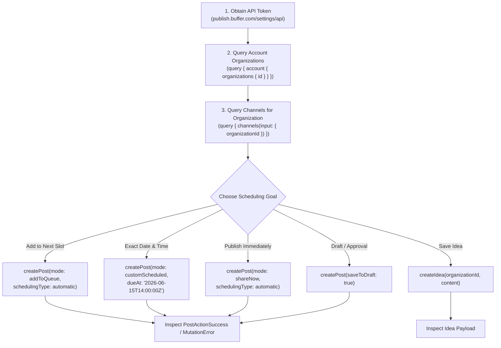

# Buffer API & Social Scheduling Integration Skill

This skill guides you through integrating the Buffer GraphQL API (`https://api.buffer.com`), official Buffer CLI (`@bufferapp/cli`), and hosted Buffer MCP Server (`https://mcp.buffer.com/mcp`) into applications, background schedulers, and AI coding agents. It covers bearer token authentication, organization and channel discovery across 11+ social networks, queue scheduling and immediate publishing, platform-specific metadata (Instagram Reels, Stories, Threads), media assets, post editing and deletion, ideas and draft workflows, and polling strategies.

---

## Core Buffer Directives & Architectural Rules

1. **GraphQL Single Endpoint Architecture**:
   - **Production Endpoint**: `https://api.buffer.com`
   - All operations (queries and mutations) are HTTP `POST` requests sending JSON payloads with a `query` string and optional `variables`.
   - Legacy REST endpoints (`api.bufferapp.com/1/...`) are deprecated in favor of the unified GraphQL schema.
2. **Bearer Token Authentication**:
   - Every request requires standard HTTP Bearer token authentication:
     ```http
     Authorization: Bearer YOUR_BUFFER_API_KEY
     Content-Type: application/json
     ```
   - Personal API keys are generated from [Buffer Settings > API](https://publish.buffer.com/settings/api).
3. **Hierarchy & ID Resolution Workflow**:
   - **Step 1: Get Organization ID**: Query `account { organizations { id name } }`. Most queries and mutations require `organizationId`.
   - **Step 2: Get Channel IDs**: Query `channels(input: { organizationId: "..." })` to retrieve connected profiles (Instagram, LinkedIn, X, etc.) and their specific `channelId`.
   - **Step 3: Act on Channels or Posts**: Schedule posts, attach media, or retrieve queues using target `channelId`s.
4. **Post Scheduling Modes (`ShareMode`)**:
   - `addToQueue`: Places post into the next available scheduled time slot defined in the channel's posting schedule.
   - `customScheduled`: Schedules for an exact future timestamp; requires the `dueAt` field (ISO 8601 UTC string, e.g., `2026-06-15T14:00:00.000Z`).
   - `shareNow`: Publishes the post immediately to the social platform.
   - `shareNext`: Places post at the top of the queue to be published at the next upcoming slot.
5. **Scheduling Types**:
   - `automatic`: Buffer publishes directly to the social network without manual intervention.
   - `notification`: Buffer sends a mobile push notification when it is time to publish (required for personal Instagram accounts or platforms requiring manual confirmation).
6. **Platform-Specific Metadata**:
   - Network options are configured via `metadata.{network}`:
     - **Instagram**: Specify `metadata: { instagram: { type: reel | story | post } }`.
     - **TikTok / YouTube Shorts**: Must include compliant video assets.
     - **Link Attachments**: Specified under network metadata (note: mutually exclusive with non-empty `assets` array).
7. **Drafts & Approval States**:
   - Pass `saveToDraft: true` in `createPost` or `editPost` to keep content as a draft rather than queuing it for automated publishing.
8. **No Webhooks (Polling Requirement)**:
   - Buffer's public API does **not** support developer webhooks.
   - Keep local databases in sync using narrow, timestamp-filtered polling (e.g., `posts(input: { filter: { status: [sent] } })` filtering by `dueAt` or `createdAt`).
9. **Rate Limit Monitoring & HTTP 429**:
   - Rate limits scale by subscription tier (Free: 150/15min, Essentials: 450/15min, Team: 1500/15min).
   - Track response headers: `RateLimit` (remaining/reset) and `RateLimit-Policy`.
   - When encountering HTTP `429 Too Many Requests`, read the `Retry-After` header and apply exponential backoff.
10. **Hosted MCP Server & CLI**:
    - AI agents can connect directly via Buffer's hosted MCP endpoint: `https://mcp.buffer.com/mcp`.
    - Developers can test and automate flows using `@bufferapp/cli` (`buffer init`, `buffer doctor`).

---

## Architecture & Integration Workflows



---

## Core Workflows

### Workflow 1: Organization & Channel Discovery
Before publishing, your application must resolve the target `organizationId` and `channelId`:

```graphql
# 1. Fetch Organization IDs
query GetAccountHierarchy {
  account {
    id
    name
    email
    organizations {
      id
      name
      isOwner
    }
  }
}
```

```graphql
# 2. Fetch Channels for Target Organization
query GetChannels($orgId: OrganizationId!) {
  channels(input: { organizationId: $orgId }) {
    id
    name
    displayName
    service
    serviceType
    avatar
    isQueuePaused
  }
}
```
> Supported `service` values include `instagram`, `linkedin`, `twitter`, `tiktok`, `facebook`, `threads`, `pinterest`, `bluesky`, `youtube`, `mastodon`, and `googlebusiness`.

### Workflow 2: Scheduling a Post to Queue (`addToQueue`)
Adds a post with an image to the channel's next posting schedule slot:

```graphql
mutation SchedulePost($input: CreatePostInput!) {
  createPost(input: $input) {
    ... on PostActionSuccess {
      post {
        id
        text
        dueAt
        status
        assets {
          id
          url
        }
      }
    }
    ... on MutationError {
      message
    }
  }
}
```
**Variables**:
```json
{
  "input": {
    "channelId": "ch_65a10f",
    "text": "Excited to announce our new feature release! 🚀 https://example.com/blog",
    "schedulingType": "automatic",
    "mode": "addToQueue",
    "assets": [
      {
        "url": "https://cdn.example.com/images/feature-banner.png",
        "mimeType": "image/png"
      }
    ]
  }
}
```

### Workflow 3: Scheduling for Specific Date & Time (`customScheduled`)
Schedules content for an exact future date:

```json
{
  "input": {
    "channelId": "ch_65a10f",
    "text": "Join us tomorrow for our live product demo!",
    "schedulingType": "automatic",
    "mode": "customScheduled",
    "dueAt": "2026-11-20T16:00:00.000Z"
  }
}
```

### Workflow 4: Instagram Reel Publishing
Publishing an Instagram Reel with dedicated video asset and metadata:

```json
{
  "input": {
    "channelId": "ch_instagram_99b",
    "text": "Top 3 productivity hacks for software engineers #dev #productivity",
    "schedulingType": "automatic",
    "mode": "addToQueue",
    "assets": [
      {
        "url": "https://cdn.example.com/videos/productivity-reel.mp4",
        "mimeType": "video/mp4"
      }
    ],
    "metadata": {
      "instagram": {
        "type": "reel"
      }
    }
  }
}
```

### Workflow 5: Editing and Deleting Posts
Modify an existing post's text or schedule via `editPost`, or remove it with `deletePost`:

```graphql
# Edit an existing post
mutation EditPost($input: EditPostInput!) {
  editPost(input: $input) {
    ... on PostActionSuccess {
      post {
        id
        text
        dueAt
      }
    }
    ... on MutationError {
      message
    }
  }
}
```

```graphql
# Delete a post
mutation DeletePost($input: DeletePostInput!) {
  deletePost(input: $input) {
    ... on DeletePostSuccess {
      id
    }
    ... on MutationError {
      message
    }
  }
}
```

---

## Reference Guides Index

| Topic | Reference Document | Description |
| :--- | :--- | :--- |
| **Complete GraphQL Schema** | [api_reference.md](./references/api_reference.md) | Full query and mutation catalog, input objects, enums, unions, and error models |
| **Authentication, CLI & MCP** | [authentication_and_setup.md](./references/authentication_and_setup.md) | API keys, OAuth 2.0 PKCE, `@bufferapp/cli` setup, and hosted Buffer MCP server config |
| **Channels & Organizations** | [channels_and_organizations.md](./references/channels_and_organizations.md) | Querying account hierarchy, channel listings across 11 platforms, queue paused status |
| **Posts & Scheduling** | [posts_and_scheduling.md](./references/posts_and_scheduling.md) | `createPost`, `editPost`, `deletePost`, scheduling modes (`addToQueue`, `customScheduled`, `shareNow`), assets |
| **Platform Metadata** | [network_specific_metadata.md](./references/network_specific_metadata.md) | Specific configurations for Instagram (Reels, Stories), Threads, X threads, TikTok, LinkedIn |
| **Ideas & Draft Workflows** | [ideas_and_drafts.md](./references/ideas_and_drafts.md) | Organization-level idea creation (`createIdea`), converting ideas into posts, draft approvals |
| **Rate Limits & Polling** | [rate_limits_and_polling.md](./references/rate_limits_and_polling.md) | Plan rate tiers (Free/Essentials/Team), response headers, 429 backoff, timestamp polling patterns |

---

## Production Integration Checklist

Before deploying your Buffer API integration to production, verify:

- [ ] **Bearer Token Protection**: Buffer API key is securely loaded via `BUFFER_API_KEY` environment variable and never exposed on the client.
- [ ] **GraphQL POST Verification**: All calls to `https://api.buffer.com` use HTTP `POST` with `Content-Type: application/json`.
- [ ] **ID Hierarchy Resolved**: Code retrieves and stores valid `organizationId` and `channelId` pairs before attempting post creation.
- [ ] **ISO 8601 UTC Timestamps**: Any `dueAt` value passed to `customScheduled` posts uses complete ISO 8601 format with timezone indicator (e.g., `2026-06-15T15:00:00.000Z`).
- [ ] **Asset Compatibility**: Media URLs are publicly accessible via HTTPS and match supported video/image formats.
- [ ] **Mutually Exclusive Attachments**: Code avoids sending both link attachments in metadata and file `assets` in the same post.
- [ ] **GraphQL Error Handling**: Logic inspects both root `errors` array and union response types (`... on MutationError`, `... on PostActionSuccess`).
- [ ] **Rate Limit Tracking**: System reads `RateLimit` headers and implements exponential backoff on `HTTP 429` with `Retry-After`.
- [ ] **Polling Sync Strategy**: For apps needing post status sync, narrow timestamp-based polling (`dueAt`/`createdAt`) is implemented instead of full-table scans.
