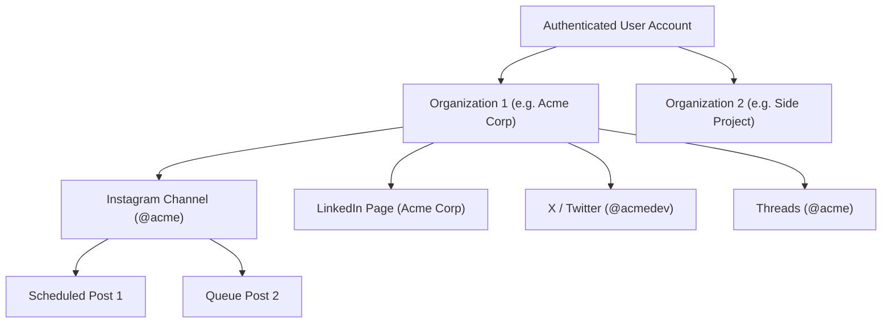

# Buffer Channels & Organizations Guide

This guide covers discovering and managing organizations and social media channels within Buffer's GraphQL API (`https://api.buffer.com`).

---

## 1. Entity Hierarchy

Buffer organizes social data in a clear hierarchy:



Before you can create a post, you must:
1. Identify the active `organizationId`.
2. Discover connected channels under that organization to obtain the target `channelId`.

---

## 2. Resolving Organizations

Query the `account` field to discover available organizations:

```graphql
query GetAccountOrganizations {
  account {
    id
    name
    email
    organizations {
      id
      name
      isOwner
      role
      plan
      channelLimit
    }
  }
}
```

### Sample Response
```json
{
  "data": {
    "account": {
      "id": "acc_6509f1a",
      "name": "Alex Taylor",
      "email": "alex@example.com",
      "organizations": [
        {
          "id": "org_99214b7e",
          "name": "Acme Marketing",
          "isOwner": true,
          "role": "admin",
          "plan": "team",
          "channelLimit": 15
        }
      ]
    }
  }
}
```

---

## 3. Querying Connected Channels

To fetch channels, pass the `organizationId` to the `channels` query:

```graphql
query GetChannels($input: ChannelsInput!) {
  channels(input: $input) {
    id
    name
    displayName
    service
    serviceType
    avatar
    isQueuePaused
    timezone
    createdAt
  }
}
```

**Variables**:
```json
{
  "input": {
    "organizationId": "org_99214b7e"
  }
}
```

### Sample Channels Response
```json
{
  "data": {
    "channels": [
      {
        "id": "ch_insta_101",
        "name": "acmedev",
        "displayName": "Acme Developers",
        "service": "instagram",
        "serviceType": "business",
        "avatar": "https://cdn.buffer.com/avatars/instagram_acmedev.jpg",
        "isQueuePaused": false,
        "timezone": "America/New_York"
      },
      {
        "id": "ch_linkedin_102",
        "name": "acme-corp",
        "displayName": "Acme Corporation",
        "service": "linkedin",
        "serviceType": "company",
        "avatar": "https://cdn.buffer.com/avatars/linkedin_acme.jpg",
        "isQueuePaused": false,
        "timezone": "America/New_York"
      }
    ]
  }
}
```

---

## 4. Supported Social Networks & `service` Codes

Buffer supports 11+ major social media platforms. Always check the `service` attribute when routing platform-specific formatting or media assets:

| Platform | `service` Value | `serviceType` Examples | Notes |
| :--- | :--- | :--- | :--- |
| **Instagram** | `instagram` | `business`, `creator`, `personal` | Business/Creator accounts support direct auto-publishing of feed, stories, and reels |
| **LinkedIn** | `linkedin` | `profile`, `company` | Supports text, images, videos, and multi-page document carousels (PDF) |
| **X (Twitter)** | `twitter` | `profile` | Character count limit of 280 (or extended with premium) |
| **TikTok** | `tiktok` | `business`, `personal` | Requires compliant MP4/MOV video assets |
| **Threads** | `threads` | `profile` | Supports text (up to 500 chars), photos, and video attachments |
| **Facebook** | `facebook` | `page`, `group` | Facebook Pages support full auto-publishing |
| **Pinterest** | `pinterest` | `board` | Requires image asset and target board selection |
| **Bluesky** | `bluesky` | `profile` | Open decentralized microblogging; 300 character limit |
| **YouTube** | `youtube` | `channel` | Video uploads and YouTube Shorts publishing |
| **Mastodon** | `mastodon` | `profile` | Federated microblogging (supports 500 character limits on most instances) |
| **Google Business** | `googlebusiness` | `location` | Local business profile updates and announcements |

---

## 5. Queue Status & Best Practices

### Checking `isQueuePaused`
Before scheduling a post with `mode: addToQueue`, inspect `isQueuePaused`:
- If `isQueuePaused: true`, posts added to the queue will not be dispatched until the queue is resumed by an admin in the Buffer dashboard.
- If you need immediate publishing regardless of queue pause state, use `mode: shareNow`.

### Multi-Channel Filtering Example (TypeScript)
```typescript
import { BufferClient } from './client';

export async function findChannelByService(serviceName: string) {
  const client = new BufferClient();

  // 1. Resolve organization
  const accountData = await client.execute(`
    query {
      account {
        organizations {
          id
          name
        }
      }
    }
  `);

  const primaryOrg = accountData.account.organizations[0];
  if (!primaryOrg) {
    throw new Error('No organizations found for this Buffer account.');
  }

  // 2. Query channels
  const channelsData = await client.execute(`
    query GetChannels($input: ChannelsInput!) {
      channels(input: $input) {
        id
        name
        displayName
        service
        isQueuePaused
      }
    }
  `, {
    input: { organizationId: primaryOrg.id }
  });

  // 3. Find matching channel
  const matched = channelsData.channels.filter(
    (ch: any) => ch.service.toLowerCase() === serviceName.toLowerCase()
  );

  return {
    organizationId: primaryOrg.id,
    channels: matched,
  };
}
```
