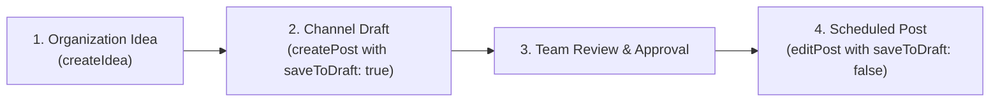

# Buffer Ideas & Draft Workflows Guide

This guide covers capturing unassigned content ideas, collaborating on brainstorms, managing drafts, and handling approval states using Buffer's GraphQL API.

---

## 1. Ideas vs. Drafts vs. Scheduled Posts



| Entity | Scope | Requires Channel? | Scheduled Time? |
| :--- | :--- | :--- | :--- |
| **Idea** | Organization-wide | No | No (brainstorming state) |
| **Draft** | Specific Channel | Yes (`channelId`) | No (unscheduled draft) |
| **Scheduled Post** | Specific Channel | Yes (`channelId`) | Yes (`dueAt` or queue slot) |

---

## 2. Managing Ideas

Ideas exist at the organization level so your team or AI agents can store content concepts before deciding which social networks to target.

### Creating an Idea (`createIdea`)
```graphql
mutation CreateIdea($input: CreateIdeaInput!) {
  createIdea(input: $input) {
    ... on Idea {
      id
      content {
        title
        text
      }
      createdAt
    }
    ... on MutationError {
      message
    }
  }
}
```

**Variables**:
```json
{
  "input": {
    "organizationId": "org_99214b7e",
    "content": {
      "title": "Post series on clean DDD architecture",
      "text": "Break down hexagonal architecture and domain boundaries into 3 short bite-sized tips for engineers."
    }
  }
}
```

### Querying Ideas (`ideas`)
```graphql
query GetIdeas($input: IdeasInput!) {
  ideas(input: $input) {
    edges {
      node {
        id
        content {
          title
          text
        }
        createdAt
        updatedAt
      }
    }
    pageInfo {
      hasNextPage
      endCursor
    }
  }
}
```

---

## 3. Creating & Managing Channel Drafts

Drafts are bound to a specific social channel (e.g., an Instagram account or LinkedIn page) but have not been placed into the publishing schedule.

### Creating a Draft (`saveToDraft: true`)
```graphql
mutation CreateDraft($input: CreatePostInput!) {
  createPost(input: $input) {
    ... on PostActionSuccess {
      post {
        id
        text
        status # Returns 'draft'
        channelId
      }
    }
    ... on MutationError {
      message
    }
  }
}
```

**Variables**:
```json
{
  "input": {
    "channelId": "ch_linkedin_102",
    "text": "Drafting an update on our Q3 customer milestones...",
    "schedulingType": "automatic",
    "mode": "addToQueue",
    "saveToDraft": true
  }
}
```

### Promoting a Draft to Scheduled (`editPost`)
To convert a draft into a scheduled post, call `editPost` with `saveToDraft: false`:

```graphql
mutation ScheduleDraft($input: EditPostInput!) {
  editPost(input: $input) {
    ... on PostActionSuccess {
      post {
        id
        text
        status # Transitions from 'draft' to 'scheduled'
        dueAt
      }
    }
    ... on MutationError {
      message
    }
  }
}
```

**Variables**:
```json
{
  "input": {
    "id": "post_draft_7721",
    "saveToDraft": false,
    "mode": "addToQueue"
  }
}
```

---

## 4. Converting an Idea into a Post

When turning an organization-level idea into a published post, pass `ideaId` to link the resulting post back to the original brainstorm:

```json
{
  "input": {
    "channelId": "ch_twitter_103",
    "text": "3 tips for clean DDD in TypeScript: 1. Strict typing 2. Hexagonal layers 3. Zero I/O in domain entities",
    "schedulingType": "automatic",
    "mode": "addToQueue",
    "ideaId": "idea_88192a"
  }
}
```
