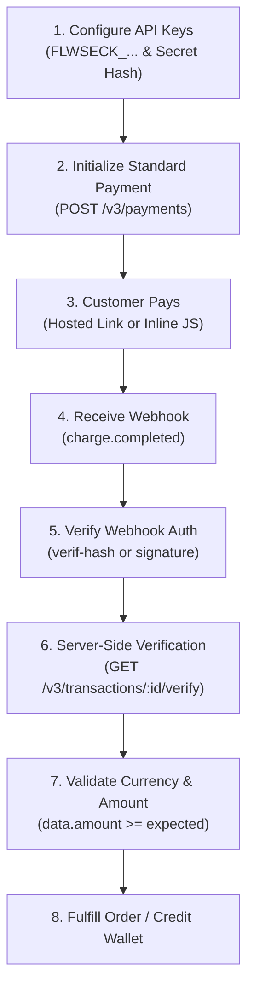

# Flutterwave Payments & API Integration Skill

This skill guides you through integrating Flutterwave API v3 (`https://api.flutterwave.com/v3`) into web and mobile backends. It covers end-to-end payment initialization, server-side transaction verification, dual webhook security, recurring tokenized debits, outbound bank transfers/payouts, Dedicated Virtual Accounts (DVA), subaccounts for split payments, and direct card encryption.

---

## Core Flutterwave Rules & Directives

1. **Major Currency Units (NOT Subunits)**:
   - **Crucial Gateway Difference**: Unlike Paystack or Stripe, Flutterwave expects amounts in **major decimal currency units**:
     - **NGN**: `5000` or `5000.00` represents ₦5,000.00 (do **not** multiply by 100 into 500,000 kobo).
     - **USD**: `10.50` represents $10.50 (do **not** send 1050 cents).
     - **KES / GHS / ZAR / EUR / GBP**: Pass standard human-readable decimal figures.
2. **Secret Key Server-Side Only**:
   - `FLWSECK_...` (Live) and `FLWSECK_TEST-...` (Test) must **strictly** remain on backend servers or environment variables (`FLUTTERWAVE_SECRET_KEY`).
   - `FLWPUBK_...` and `FLWPUBK_TEST-...` are public keys for client-side popups (Flutterwave Inline JS).
3. **Always Verify on the Server Before Granting Value**:
   - Never trust frontend redirect query parameters (`status=successful`, `tx_ref`, or `transaction_id`).
   - Query Flutterwave directly via **Server-Side Verification** (`GET /v3/transactions/:id/verify`) or await a signed **Webhook Notification** (`charge.completed`) before crediting a wallet or fulfilling an order.
4. **Status Check Value is `"successful"`**:
   - Notice the spelling: when inspecting transaction verification responses (`data.status`), the successful state string is **`"successful"`** (with `-ful`), **not** `"success"`. The outer response envelope has `status: "success"`, while `data.status === "successful"`.
5. **Dual Webhook Authentication**:
   - Flutterwave signs webhooks using the **Secret Hash** configured in your Dashboard (**Settings > Webhooks**).
   - Check incoming headers for `verif-hash` (plain string secret hash match) and/or `flutterwave-signature` (HMAC-SHA256 hash of the raw request body).
   - Verify signatures against the **raw, unparsed body** using a timing-safe equality check (`crypto.timingSafeEqual`).
6. **Unique Idempotent References (`tx_ref`)**:
   - Always supply a unique `tx_ref` for each payment and transfer to prevent accidental double-charging or duplicate payouts.
7. **Test OTP is `12345`**:
   - For sandbox card authentication simulating OTP, the standard OTP is **`12345`** (5 digits), not `123456`.

---

## Standard Integration Workflows

### Workflow 1: Standard Checkout & Server Verification
1. **Initialize Payment**: Call `POST https://api.flutterwave.com/v3/payments` with:
   - `tx_ref`: Unique transaction reference generated by your app.
   - `amount`: Monetary amount in major units (e.g., `15000` for ₦15,000.00).
   - `currency`: 3-letter ISO currency code (`NGN`, `USD`, `KES`, `GHS`, etc.).
   - `redirect_url`: Return callback URL for customer redirect after checkout.
   - `customer`: Customer details (`email` required, `name`, `phone_number` optional).
   - `customizations`: Branding metadata (`title`, `description`, `logo`).
2. **Redirect Customer**: Direct user browser to `data.link` returned in the response.
3. **Handle Redirect Callback**: On `redirect_url?status=successful&tx_ref=...&transaction_id=...`, read `transaction_id`.
4. **Server Verification**: Call `GET https://api.flutterwave.com/v3/transactions/:id/verify` using `FLWSECK_...`.
5. **Enforce Invariants**:
   - Outer `status === "success"`
   - `data.status === "successful"`
   - `data.tx_ref === expectedTxRef`
   - `data.currency === expectedCurrency`
   - `data.amount >= expectedAmount`
> See [payment_flows.md](./references/payment_flows.md) for complete implementations in TypeScript, Python, and Go.

### Workflow 2: Dual Webhook Security & Order Fulfillment
1. Capture the **raw HTTP request body** buffer/string before JSON parsing.
2. Inspect the request headers for `verif-hash` or `flutterwave-signature`:
   - If `verif-hash` is present, compare it directly to your configured secret hash using timing-safe comparison.
   - If `flutterwave-signature` is present, compute HMAC-SHA256 of the raw body using your secret hash and compare.
3. Return HTTP `200 OK` immediately to acknowledge receipt and prevent timeout retries.
4. Perform an outbound query to `GET /v3/transactions/:id/verify` to confirm authenticity against Flutterwave's ledger.
5. Asynchronously process the event:
   - `charge.completed`: Verify transaction and mark order/wallet as funded.
   - `transfer.completed`: Mark payout as `SUCCESSFUL` or handle balance rollback on `FAILED`.
> See [webhook_handling.md](./references/webhook_handling.md) for framework-specific implementations (Express, Next.js App Router, FastAPI, Django).

### Workflow 3: Outbound Transfers & Payouts
1. **Resolve Bank Account**: Call `POST https://api.flutterwave.com/v3/accounts/resolve` with `account_number` and `account_bank` (bank code) to confirm recipient account name.
2. **Check Transfer Fee**: Call `GET https://api.flutterwave.com/v3/transfers/fee?amount=...&currency=...`.
3. **Initiate Transfer**: Call `POST https://api.flutterwave.com/v3/transfers` with `account_bank`, `account_number`, `amount`, `currency`, `narration`, and unique `reference`.
4. **Listen for Webhook**: Finalize payout status when receiving `transfer.completed` (`status === "SUCCESSFUL"` or `status === "FAILED"`).
> See [transfers_and_payouts.md](./references/transfers_and_payouts.md).

### Workflow 4: Dedicated Virtual Accounts (DVA)
1. **Create Static Virtual Account**: Call `POST https://api.flutterwave.com/v3/virtual-account-numbers` with:
   - `email`: Customer email
   - `is_permanent: true`: Indicates a permanent wallet-funding account
   - `bvn`: Customer 11-digit Bank Verification Number (mandatory for live Nigerian accounts)
   - `tx_ref`: Unique reference linking customer to this account
   - `firstname`, `lastname`, `phonenumber`, `narration`
2. **Receive Deposits**: Flutterwave triggers a `charge.completed` webhook (`payment_type: "bank_transfer"`) when funds are transferred into the account.
3. **Credit Customer Wallet**: Match `data.customer.email` or `data.tx_ref` and credit user account.
> See [virtual_accounts_and_subaccounts.md](./references/virtual_accounts_and_subaccounts.md).

### Workflow 5: Subaccounts & Split Payments
1. **Create Subaccount**: Call `POST https://api.flutterwave.com/v3/subaccounts` with `account_bank`, `account_number`, `business_name`, `split_type` (`"percentage"` or `"flat"`), and `split_value` (e.g., `0.2` for 20% or `500` for flat ₦500).
2. **Split on Checkout**: Pass `subaccounts` array in `POST /v3/payments` to distribute funds to one or multiple vendors automatically upon successful payment.
> See [virtual_accounts_and_subaccounts.md](./references/virtual_accounts_and_subaccounts.md).

### Workflow 6: Tokenized Recurring Charges
1. **Extract Token**: On customer's first successful card payment, extract `data.card.token` from `GET /v3/transactions/:id/verify`.
2. **Store Securely**: Save `token` alongside customer `email` in your database.
3. **Execute Recurring Charge**: Call `POST https://api.flutterwave.com/v3/tokenized-charges` with `token`, `email` (must match exact initial email), `currency`, `amount`, and unique `tx_ref`.
> See [payment_flows.md](./references/payment_flows.md).

---

## Reference Guides Index

| Topic | Reference Document | Description |
| :--- | :--- | :--- |
| **All API Endpoints** | [api_reference.md](./references/api_reference.md) | Complete v3 endpoint reference, parameters, and headers |
| **Payment & Checkout Flows** | [payment_flows.md](./references/payment_flows.md) | Standard Hosted Link, Inline JS SDK, Tokenized Charges, 3DES Encryption |
| **Webhook Security & Signatures** | [webhook_handling.md](./references/webhook_handling.md) | Dual `verif-hash` & `flutterwave-signature` checks with Express, Next.js, FastAPI, Django |
| **Transfers & Payouts** | [transfers_and_payouts.md](./references/transfers_and_payouts.md) | Account resolution, single/bulk transfers, fee checks, retry logic |
| **Virtual Accounts & Subaccounts** | [virtual_accounts_and_subaccounts.md](./references/virtual_accounts_and_subaccounts.md) | Static/Dynamic Virtual NUBANs, BVN KYC, and Marketplace Split Payments |
| **Testing, Cards & Troubleshooting** | [troubleshooting_and_testing.md](./references/troubleshooting_and_testing.md) | Sandbox setup, test card numbers, OTPs, mock accounts, and error codes |

---

## Production Integration Checklist

Before deploying your Flutterwave integration to production, verify:

- [ ] **Secret Key Protection**: `FLWSECK_...` is stored exclusively in environment variables and never exposed in client bundles or public repositories.
- [ ] **Major Currency Units**: All payment amounts are passed as standard decimal values (e.g. `5000` for ₦5,000.00), **not** multiplied by 100 into subunits.
- [ ] **Status String Validation**: Backend checks explicitly evaluate `data.status === "successful"`, **not** `"success"`.
- [ ] **Amount and Currency Validation**: Backend verifies `data.currency === expectedCurrency` and `data.amount >= expectedAmount` before granting value.
- [ ] **Dual Webhook Authentication**: Webhook routes check `verif-hash` or `flutterwave-signature` HMAC-SHA256 against raw unparsed request payloads.
- [ ] **Anti-Tampering Server Verification**: Webhooks trigger a fresh `GET /v3/transactions/:id/verify` call to Flutterwave before fulfilling orders.
- [ ] **Unique `tx_ref`**: All payments, recurring charges, and payouts use a cryptographically unique `tx_ref` (e.g. UUIDv4 or nanoID).
- [ ] **Immediate 200 OK Response**: Webhook handlers acknowledge incoming notifications with HTTP 200 immediately before invoking asynchronous background workers.
- [ ] **IP Whitelisting (Payouts)**: Production server outbound IP addresses are whitelisted in Flutterwave Dashboard (**Settings > Security**) if API transfers are used.
