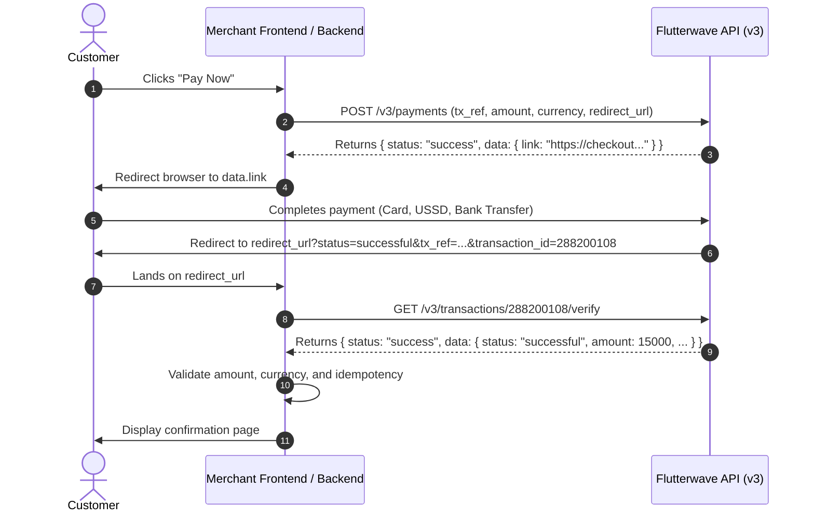

# Flutterwave Payment Flows & Implementation Guide

This guide details the core payment integration patterns: Server-to-Server Hosted Checkout, Flutterwave Inline JavaScript v3 Modal, Tokenized Recurring Debits, Preauthorization & Capture, and Direct Card Charge with 3DES encryption.

---

## 1. Server-to-Server Hosted Checkout Flow (Redirect Mode)

Ideal for backends seeking a secure, hosted checkout experience without embedding client-side SDKs.

### Architecture Flow


### TypeScript / Node.js Implementation
```typescript
import axios from 'axios';
import crypto from 'crypto';

interface InitializePaymentParams {
  amount: number; // In major units, e.g. 15000 for ₦15,000
  currency?: string; // e.g. "NGN", "USD", "KES"
  email: string;
  name?: string;
  phoneNumber?: string;
  redirectUrl: string;
  meta?: Record<string, any>;
  customizations?: {
    title?: string;
    description?: string;
    logo?: string;
  };
}

export class FlutterwaveService {
  private readonly baseUrl = 'https://api.flutterwave.com/v3';
  private readonly secretKey: string;

  constructor(secretKey: string = process.env.FLUTTERWAVE_SECRET_KEY!) {
    if (!secretKey) throw new Error('FLUTTERWAVE_SECRET_KEY is required');
    this.secretKey = secretKey;
  }

  async initializePayment(params: InitializePaymentParams) {
    const txRef = `tx_${crypto.randomUUID()}`;

    const payload = {
      tx_ref: txRef,
      amount: params.amount, // Major currency units (NO * 100)
      currency: params.currency ?? 'NGN',
      redirect_url: params.redirectUrl,
      customer: {
        email: params.email,
        name: params.name,
        phonenumber: params.phoneNumber,
      },
      meta: params.meta,
      customizations: params.customizations,
    };

    const response = await axios.post(`${this.baseUrl}/payments`, payload, {
      headers: {
        Authorization: `Bearer ${this.secretKey}`,
        'Content-Type': 'application/json',
      },
    });

    if (response.data.status !== 'success') {
      throw new Error(`Payment initialization failed: ${response.data.message}`);
    }

    return {
      checkoutUrl: response.data.data.link,
      txRef,
    };
  }

  async verifyTransaction(transactionId: string | number, expected: {
    expectedTxRef: string;
    expectedAmount: number;
    expectedCurrency: string;
  }) {
    const response = await axios.get(
      `${this.baseUrl}/transactions/${transactionId}/verify`,
      {
        headers: {
          Authorization: `Bearer ${this.secretKey}`,
          'Content-Type': 'application/json',
        },
      }
    );

    const body = response.data;
    if (body.status !== 'success') {
      throw new Error(`Verification request failed: ${body.message}`);
    }

    const data = body.data;

    // Strict invariant checks
    if (data.status !== 'successful') {
      throw new Error(`Transaction unfulfilled: status is ${data.status}`);
    }
    if (data.tx_ref !== expected.expectedTxRef) {
      throw new Error(`Reference mismatch: expected ${expected.expectedTxRef}, got ${data.tx_ref}`);
    }
    if (data.currency !== expected.expectedCurrency) {
      throw new Error(`Currency mismatch: expected ${expected.expectedCurrency}, got ${data.currency}`);
    }
    if (Number(data.amount) < expected.expectedAmount) {
      throw new Error(`Amount underpayment: expected at least ${expected.expectedAmount}, got ${data.amount}`);
    }

    return {
      isVerified: true,
      transactionId: data.id,
      flwRef: data.flw_ref,
      cardToken: data.card?.token,
      customer: data.customer,
      raw: data,
    };
  }
}
```

### Python Implementation (httpx)
```python
import os
import uuid
from typing import Any, Dict, Optional
import httpx

class FlutterwaveClient:
    def __init__(self, secret_key: Optional[str] = None):
        self.secret_key = secret_key or os.getenv("FLUTTERWAVE_SECRET_KEY")
        if not self.secret_key:
            raise ValueError("FLUTTERWAVE_SECRET_KEY is required")
        self.base_url = "https://api.flutterwave.com/v3"
        self.headers = {
            "Authorization": f"Bearer {self.secret_key}",
            "Content-Type": "application/json",
            "Accept": "application/json",
        }

    async def initialize_payment(
        self,
        amount: float,
        email: str,
        redirect_url: str,
        currency: str = "NGN",
        name: Optional[str] = None,
        phone_number: Optional[str] = None,
        customizations: Optional[Dict[str, str]] = None,
    ) -> Dict[str, Any]:
        tx_ref = f"tx_{uuid.uuid4().hex}"
        payload = {
            "tx_ref": tx_ref,
            "amount": amount,  # Major units (e.g. 5000.00)
            "currency": currency,
            "redirect_url": redirect_url,
            "customer": {
                "email": email,
                "name": name,
                "phonenumber": phone_number,
            },
            "customizations": customizations or {},
        }

        async with httpx.AsyncClient() as client:
            resp = await client.post(
                f"{self.base_url}/payments", json=payload, headers=self.headers, timeout=10.0
            )
            resp.raise_for_status()
            data = resp.json()

            if data.get("status") != "success":
                raise RuntimeError(f"Payment init failed: {data.get('message')}")

            return {
                "checkout_url": data["data"]["link"],
                "tx_ref": tx_ref,
            }

    async def verify_transaction(
        self,
        transaction_id: int,
        expected_tx_ref: str,
        expected_amount: float,
        expected_currency: str = "NGN",
    ) -> Dict[str, Any]:
        async with httpx.AsyncClient() as client:
            resp = await client.get(
                f"{self.base_url}/transactions/{transaction_id}/verify",
                headers=self.headers,
                timeout=10.0,
            )
            resp.raise_for_status()
            body = resp.json()

            if body.get("status") != "success":
                raise RuntimeError(f"Verification request failed: {body.get('message')}")

            data = body["data"]

            # Critical Invariants
            if data.get("status") != "successful":
                raise ValueError(f"Transaction not successful: {data.get('status')}")
            if data.get("tx_ref") != expected_tx_ref:
                raise ValueError(f"tx_ref mismatch: expected {expected_tx_ref}, got {data.get('tx_ref')}")
            if data.get("currency") != expected_currency:
                raise ValueError(f"Currency mismatch: expected {expected_currency}, got {data.get('currency')}")
            if float(data.get("amount", 0)) < expected_amount:
                raise ValueError(f"Underpayment: expected {expected_amount}, got {data.get('amount')}")

            return data
```

---

## 2. Client-Side Flutterwave Inline JavaScript SDK v3

The Inline JS modal opens a pop-up directly over your website.

```html
<!DOCTYPE html>
<html lang="en">
<head>
  <meta charset="UTF-8">
  <title>Flutterwave Inline Checkout</title>
  <!-- Load official Flutterwave Inline v3 SDK -->
  <script src="https://checkout.flutterwave.com/v3.js"></script>
</head>
<body>
  <button type="button" id="pay-btn">Pay ₦15,000</button>

  <script>
    document.getElementById('pay-btn').addEventListener('click', function () {
      FlutterwaveCheckout({
        public_key: "FLWPUBK_TEST-SANDBOXDEMOKEY-X",
        tx_ref: "tx_inline_" + Date.now(),
        amount: 15000, // In major units
        currency: "NGN",
        payment_options: "card, banktransfer, ussd",
        customer: {
          email: "customer@example.com",
          phonenumber: "08012345678",
          name: "Jane Doe",
        },
        customizations: {
          title: "My Store",
          description: "Payment for order #1002",
          logo: "https://yourdomain.com/logo.png",
        },
        callback: function (response) {
          // Send transaction_id to your backend server for server-side verification!
          fetch("/api/payments/verify", {
            method: "POST",
            headers: { "Content-Type": "application/json" },
            body: JSON.stringify({
              transaction_id: response.transaction_id,
              tx_ref: response.tx_ref
            })
          })
          .then(res => res.json())
          .then(data => {
            if (data.success) {
              window.location.href = "/order/success";
            } else {
              alert("Payment verification failed");
            }
          });
        },
        onclose: function () {
          console.log("Customer closed the checkout modal.");
        }
      });
    });
  </script>
</body>
</html>
```

---

## 3. Tokenized Recurring Charges

Once a customer completes an initial payment, extract `data.card.token` from `GET /v3/transactions/:id/verify`. Store this token securely to charge the card on a recurring schedule without prompting the user.

```typescript
// Recurring charge implementation in TypeScript
export async function executeTokenizedCharge(params: {
  token: string;
  customerEmail: string; // Must match original charge email
  amount: number;        // In major units
  currency: string;
  txRef: string;
  narration?: string;
}) {
  const response = await axios.post(
    'https://api.flutterwave.com/v3/tokenized-charges',
    {
      token: params.token,
      email: params.customerEmail,
      amount: params.amount,
      currency: params.currency,
      tx_ref: params.txRef,
      narration: params.narration ?? 'Recurring Subscription Charge',
    },
    {
      headers: {
        Authorization: `Bearer ${process.env.FLUTTERWAVE_SECRET_KEY}`,
        'Content-Type': 'application/json',
      },
    }
  );

  const data = response.data;
  if (data.status !== 'success' || data.data.status !== 'successful') {
    throw new Error(`Tokenized charge failed: ${data.message || data.data?.processor_response}`);
  }

  return data.data;
}
```

---

## 4. Preauthorization & Capture Flow

Preauthorization places a hold on funds without settling them immediately. Commonly used for ride-hailing, hotels, or rental deposits.

1. **Initiate Preauth**: Pass `"preauthorize": true` when charging a card:
   ```http
   POST https://api.flutterwave.com/v3/charges?type=card
   ```
2. **Capture Funds**: When the service is delivered, capture all or a portion of the held funds:
   ```http
   POST https://api.flutterwave.com/v3/charges/{flw_ref}/capture
   Content-Type: application/json
   Authorization: Bearer FLWSECK_...

   {
     "amount": 12000
   }
   ```
3. **Void Hold**: If the reservation is cancelled, release the hold:
   ```http
   POST https://api.flutterwave.com/v3/charges/{flw_ref}/void
   ```

---

## 5. Direct Card Charge Encryption (3DES Algorithm)

When initiating direct server-to-server card charges (`POST /v3/charges?type=card`), Flutterwave requires encrypting the sensitive card payload using **Triple-DES (3DES)**.

### Encryption Key Generation
If you do not have the encryption key from your Dashboard (**Settings > API Keys > Encryption Key**), you can derive it from your Secret Key:
1. Strip `FLWSECK-` from your secret key.
2. Compute `MD5(secretKey)`.
3. Concatenate the first 12 characters of the stripped key with the last 12 characters of the MD5 hash.

### Node.js Encryption Helper (using `node-forge`)
```typescript
import forge from 'node-forge';

export function encryptPayload(key: string, payload: Record<string, any>): string {
  const text = JSON.stringify(payload);
  const cipher = forge.cipher.createCipher('3DES-CBC', forge.util.createBuffer(key));
  cipher.start({ iv: forge.util.createBuffer(key.slice(0, 8)) });
  cipher.update(forge.util.createBuffer(text, 'utf8'));
  cipher.finish();
  return forge.util.encode64(cipher.output.getBytes());
}
```
Then send:
```json
{
  "client": "ENCRYPTED_BASE64_STRING"
}
```
