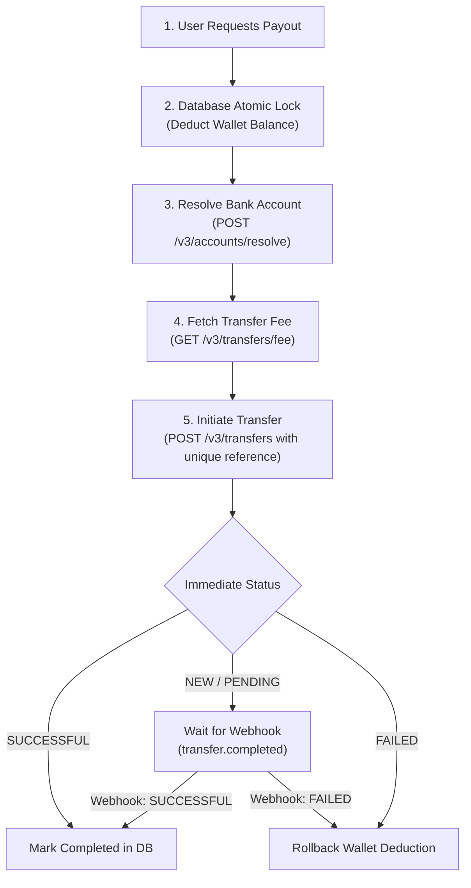

# Flutterwave Transfers & Outbound Payouts Guide

This guide covers outbound disbursements (payouts) using the Flutterwave API v3 to bank accounts and mobile money wallets across Africa and globally.

---

## 1. Payout Prerequisites & Architecture

Before initiating transfers via the API:
1. **Transfer Balance**: Ensure your Flutterwave merchant balance holds sufficient funds for the principal amount plus transaction fees.
2. **Dashboard IP Whitelisting**: If configured in your Flutterwave dashboard (**Settings > Security**), ensure the outbound IP address of your application server is whitelisted.
3. **Pessimistic Balance Locking**: On your backend, lock user wallet balances with database row-level locking (`SELECT ... FOR UPDATE`) inside an atomic transaction before dispatching a transfer request.



---

## 2. Step 1: Bank Account Resolution (NUBAN)

Always resolve the recipient's bank account before initiating a payout to confirm the beneficiary's legal account name.

```http
POST https://api.flutterwave.com/v3/accounts/resolve
Authorization: Bearer FLWSECK_...
Content-Type: application/json

{
  "account_number": "0690000032",
  "account_bank": "044"
}
```

#### Response (`200 OK`)
```json
{
  "status": "success",
  "message": "Account details fetched",
  "data": {
    "account_number": "0690000032",
    "account_name": "JOHN DOE"
  }
}
```

---

## 3. Step 2: Fetch Transfer Fee

Query applicable transaction fees before debiting users for transfer costs:

```http
GET https://api.flutterwave.com/v3/transfers/fee?amount=10000&currency=NGN
Authorization: Bearer FLWSECK_...
```

#### Response (`200 OK`)
```json
{
  "status": "success",
  "message": "Fee fetched",
  "data": [
    {
      "fee_type": "merchant",
      "currency": "NGN",
      "fee": 45
    }
  ]
}
```

---

## 4. Step 3: Single Transfer Initiation

```http
POST https://api.flutterwave.com/v3/transfers
Authorization: Bearer FLWSECK_...
Content-Type: application/json

{
  "account_bank": "044",
  "account_number": "0690000032",
  "amount": 5000,
  "currency": "NGN",
  "narration": "Vendor Settlement #84920",
  "reference": "payout_84920_a92f01",
  "debit_currency": "NGN",
  "callback_url": "https://yourapp.com/api/webhooks/flutterwave"
}
```

#### Response (`200 OK`)
```json
{
  "status": "success",
  "message": "Transfer Queued Successfully",
  "data": {
    "id": 8416497,
    "account_number": "0690000032",
    "bank_code": "044",
    "full_name": "JOHN DOE",
    "created_at": "2026-11-12T15:00:00.000Z",
    "currency": "NGN",
    "amount": 5000,
    "fee": 45,
    "status": "NEW",
    "reference": "payout_84920_a92f01",
    "narration": "Vendor Settlement #84920",
    "complete_message": "",
    "requires_approval": 0,
    "is_approved": 1,
    "bank_name": "ACCESS BANK NIGERIA"
  }
}
```

---

## 5. Step 4: Bulk Transfers

When processing payroll or large-scale batch disbursements, use the bulk transfers endpoint:

```http
POST https://api.flutterwave.com/v3/bulk-transfers
Authorization: Bearer FLWSECK_...
Content-Type: application/json

{
  "title": "Monthly Vendor Batch #11",
  "bulk_data": [
    {
      "account_bank": "044",
      "account_number": "0690000032",
      "amount": 25000,
      "currency": "NGN",
      "narration": "Vendor 1 payout",
      "reference": "bulk_payout_11_01"
    },
    {
      "account_bank": "058",
      "account_number": "0123456789",
      "amount": 18500,
      "currency": "NGN",
      "narration": "Vendor 2 payout",
      "reference": "bulk_payout_11_02"
    }
  ]
}
```

---

## 6. TypeScript Transfer Service Implementation

```typescript
import axios from 'axios';
import crypto from 'crypto';

interface TransferRecipient {
  accountBank: string;
  accountNumber: string;
  amount: number; // Major units (e.g. 5000 for ₦5,000)
  currency?: string;
  narration?: string;
}

export class FlutterwaveTransferService {
  private readonly baseUrl = 'https://api.flutterwave.com/v3';
  private readonly secretKey: string;

  constructor(secretKey: string = process.env.FLUTTERWAVE_SECRET_KEY!) {
    if (!secretKey) throw new Error('FLUTTERWAVE_SECRET_KEY is required');
    this.secretKey = secretKey;
  }

  async resolveAccount(accountNumber: string, bankCode: string): Promise<string> {
    const res = await axios.post(
      `${this.baseUrl}/accounts/resolve`,
      { account_number: accountNumber, account_bank: bankCode },
      { headers: { Authorization: `Bearer ${this.secretKey}` } }
    );
    if (res.data.status !== 'success') {
      throw new Error(`Failed to resolve account: ${res.data.message}`);
    }
    return res.data.data.account_name;
  }

  async initiateTransfer(params: TransferRecipient) {
    const reference = `tr_${crypto.randomUUID()}`;

    const res = await axios.post(
      `${this.baseUrl}/transfers`,
      {
        account_bank: params.accountBank,
        account_number: params.accountNumber,
        amount: params.amount,
        currency: params.currency ?? 'NGN',
        narration: params.narration ?? 'Disbursement',
        reference,
        debit_currency: params.currency ?? 'NGN',
      },
      {
        headers: {
          Authorization: `Bearer ${this.secretKey}`,
          'Content-Type': 'application/json',
        },
      }
    );

    const body = res.data;
    if (body.status !== 'success') {
      throw new Error(`Transfer initiation failed: ${body.message}`);
    }

    return {
      transferId: body.data.id,
      reference,
      status: body.data.status, // "NEW", "PENDING", or "SUCCESSFUL"
      fee: body.data.fee,
      data: body.data,
    };
  }

  async getTransferStatus(transferId: number | string) {
    const res = await axios.get(`${this.baseUrl}/transfers/${transferId}`, {
      headers: { Authorization: `Bearer ${this.secretKey}` },
    });
    return res.data.data;
  }
}
```

---

## 7. Python Implementation

```python
import os
import uuid
from typing import Dict, Any
import httpx

class FlutterwavePayouts:
    def __init__(self, secret_key: str = None):
        self.secret_key = secret_key or os.getenv("FLUTTERWAVE_SECRET_KEY")
        if not self.secret_key:
            raise ValueError("FLUTTERWAVE_SECRET_KEY is required")
        self.base_url = "https://api.flutterwave.com/v3"
        self.headers = {
            "Authorization": f"Bearer {self.secret_key}",
            "Content-Type": "application/json",
        }

    async def resolve_account(self, account_number: str, bank_code: str) -> str:
        async with httpx.AsyncClient() as client:
            resp = await client.post(
                f"{self.base_url}/accounts/resolve",
                json={"account_number": account_number, "account_bank": bank_code},
                headers=self.headers,
                timeout=10.0,
            )
            resp.raise_for_status()
            data = resp.json()
            if data.get("status") != "success":
                raise ValueError(f"Account resolution failed: {data.get('message')}")
            return data["data"]["account_name"]

    async def initiate_transfer(
        self,
        account_number: str,
        bank_code: str,
        amount: float,
        currency: str = "NGN",
        narration: str = "Payout",
    ) -> Dict[str, Any]:
        reference = f"tr_{uuid.uuid4().hex}"
        payload = {
            "account_bank": bank_code,
            "account_number": account_number,
            "amount": amount,
            "currency": currency,
            "narration": narration,
            "reference": reference,
            "debit_currency": currency,
        }
        async with httpx.AsyncClient() as client:
            resp = await client.post(
                f"{self.base_url}/transfers",
                json=payload,
                headers=self.headers,
                timeout=15.0,
            )
            resp.raise_for_status()
            body = resp.json()
            if body.get("status") != "success":
                raise RuntimeError(f"Transfer failed: {body.get('message')}")
            return body["data"]
```
