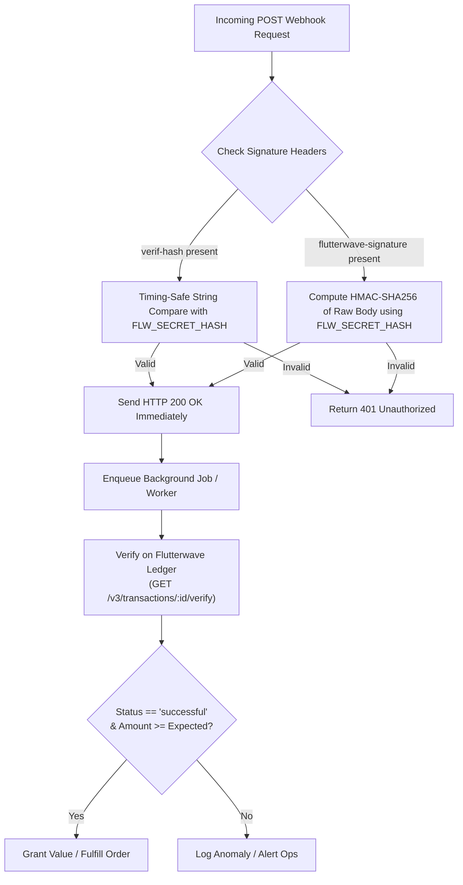

# Flutterwave Webhook Handling & Security Guide

Webhooks notify your application of asynchronous events such as completed payments, recurring subscription renewals, or outbound transfer statuses.

---

## 1. Webhook Security & Verification Architecture

Flutterwave sends event notifications as HTTP `POST` requests. Because webhook endpoints are public URLs, you must authenticate incoming requests.



### Dual Verification Strategy
1. **`verif-hash`**: Contains the plain-text Secret Hash string you defined in your Flutterwave Dashboard (**Settings > Webhooks**).
2. **`flutterwave-signature`**: Contains an HMAC-SHA256 signature computed over the raw unparsed request body using your secret hash.

Always perform comparisons using **timing-safe equality** (`crypto.timingSafeEqual` in Node.js, `hmac.compare_digest` in Python, `subtle.ConstantTimeCompare` in Go) to prevent side-channel timing attacks.

---

## 2. Mandatory Anti-Tampering Server Verification

Even when a webhook's signature is valid, production applications **must always make a secondary server verification call** to `GET /v3/transactions/{id}/verify` before dispensing value.
- Confirms the transaction exists directly on Flutterwave's authoritative database.
- Guarantees the settled amount (`data.amount`) is greater than or equal to the expected cart total.
- Guarantees the currency matches (`data.currency === order.currency`).

---

## 3. Node.js & Express Implementation

### Raw Body Capture Configuration
```typescript
import express, { Request, Response } from 'express';
import crypto from 'crypto';
import axios from 'axios';

const app = express();

// Capture raw body buffer for HMAC calculation
app.use(
  express.json({
    verify: (req: any, _res, buf) => {
      req.rawBody = buf;
    },
  })
);

interface ExtendedRequest extends Request {
  rawBody?: Buffer;
}

app.post('/api/webhooks/flutterwave', async (req: ExtendedRequest, res: Response) => {
  const secretHash = process.env.FLUTTERWAVE_SECRET_HASH;
  if (!secretHash) {
    console.error('FLUTTERWAVE_SECRET_HASH is not set');
    return res.status(500).send('Configuration error');
  }

  // 1. Check verif-hash header
  const verifHash = req.headers['verif-hash'] as string | undefined;
  const flwSignature = req.headers['flutterwave-signature'] as string | undefined;

  let isAuthenticated = false;

  if (verifHash) {
    const hashBuffer = Buffer.from(verifHash);
    const secretBuffer = Buffer.from(secretHash);
    if (hashBuffer.length === secretBuffer.length && crypto.timingSafeEqual(hashBuffer, secretBuffer)) {
      isAuthenticated = true;
    }
  } else if (flwSignature && req.rawBody) {
    const computedHash = crypto
      .createHmac('sha256', secretHash)
      .update(req.rawBody)
      .digest('hex');

    const signatureBuffer = Buffer.from(flwSignature);
    const computedBuffer = Buffer.from(computedHash);
    if (signatureBuffer.length === computedBuffer.length && crypto.timingSafeEqual(signatureBuffer, computedBuffer)) {
      isAuthenticated = true;
    }
  }

  if (!isAuthenticated) {
    return res.status(401).send('Unauthorized signature');
  }

  // 2. Acknowledge receipt immediately to avoid timeouts
  res.status(200).json({ received: true });

  // 3. Process event asynchronously
  const payload = req.body;
  const eventType = payload['event.type'] || payload.type || payload.event;

  try {
    if (eventType === 'charge.completed' || payload.event === 'charge.completed') {
      await handleChargeCompleted(payload.data);
    } else if (eventType === 'Transfer' || payload.event === 'transfer.completed') {
      await handleTransferCompleted(payload.data);
    }
  } catch (err) {
    console.error('Error processing webhook event asynchronously:', err);
  }
});

async function handleChargeCompleted(data: any) {
  const transactionId = data.id;

  // Anti-tampering secondary verification
  const verifyRes = await axios.get(
    `https://api.flutterwave.com/v3/transactions/${transactionId}/verify`,
    {
      headers: {
        Authorization: `Bearer ${process.env.FLUTTERWAVE_SECRET_KEY}`,
      },
    }
  );

  const verifiedData = verifyRes.data.data;
  if (verifiedData.status !== 'successful') {
    console.warn(`Transaction ${transactionId} verification status is ${verifiedData.status}`);
    return;
  }

  // Idempotently fulfill order in your database
  console.log(`Order ${verifiedData.tx_ref} fulfilled for amount ${verifiedData.amount} ${verifiedData.currency}`);
}

async function handleTransferCompleted(data: any) {
  const reference = data.reference;
  const status = data.status; // "SUCCESSFUL" or "FAILED"

  console.log(`Transfer payout ${reference} concluded with status: ${status}`);
  // Update disbursement status in database
}
```

---

## 4. Next.js App Router (`route.ts`)

```typescript
// app/api/webhooks/flutterwave/route.ts
import { NextRequest, NextResponse } from 'next/server';
import crypto from 'crypto';

export async function POST(req: NextRequest) {
  const secretHash = process.env.FLUTTERWAVE_SECRET_HASH;
  if (!secretHash) {
    return NextResponse.json({ error: 'Config missing' }, { status: 500 });
  }

  const verifHash = req.headers.get('verif-hash');
  const flwSignature = req.headers.get('flutterwave-signature');
  const rawBodyText = await req.text();

  let isAuthenticated = false;

  if (verifHash) {
    const hashBuffer = Buffer.from(verifHash);
    const secretBuffer = Buffer.from(secretHash);
    if (hashBuffer.length === secretBuffer.length && crypto.timingSafeEqual(hashBuffer, secretBuffer)) {
      isAuthenticated = true;
    }
  } else if (flwSignature) {
    const computedHash = crypto
      .createHmac('sha256', secretHash)
      .update(rawBodyText)
      .digest('hex');

    const signatureBuffer = Buffer.from(flwSignature);
    const computedBuffer = Buffer.from(computedHash);
    if (signatureBuffer.length === computedBuffer.length && crypto.timingSafeEqual(signatureBuffer, computedBuffer)) {
      isAuthenticated = true;
    }
  }

  if (!isAuthenticated) {
    return NextResponse.json({ error: 'Invalid signature' }, { status: 401 });
  }

  const payload = JSON.parse(rawBodyText);

  // Dispatch event to queue / worker asynchronously
  // (e.g. Inngest, BullMQ, Cloud Tasks)
  queueMicrotask(async () => {
    // Perform secondary server verification and order update
  });

  return NextResponse.json({ status: 'ok' }, { status: 200 });
}
```

---

## 5. Python FastAPI Implementation

```python
import hmac
import hashlib
import os
from fastapi import FastAPI, Request, HTTPException, BackgroundTasks, status
import httpx

app = FastAPI()

FLW_SECRET_HASH = os.getenv("FLUTTERWAVE_SECRET_HASH", "")
FLW_SECRET_KEY = os.getenv("FLUTTERWAVE_SECRET_KEY", "")

async def verify_and_fulfill(data: dict):
    transaction_id = data.get("id")
    async with httpx.AsyncClient() as client:
        resp = await client.get(
            f"https://api.flutterwave.com/v3/transactions/{transaction_id}/verify",
            headers={"Authorization": f"Bearer {FLW_SECRET_KEY}"},
            timeout=10.0,
        )
        if resp.status_code == 200:
            verified = resp.json().get("data", {})
            if verified.get("status") == "successful":
                # Fulfill order in DB
                print(f"Verified & credited {verified.get('tx_ref')}")

@app.post("/api/webhooks/flutterwave", status_code=status.HTTP_200_OK)
async def flutterwave_webhook(request: Request, background_tasks: BackgroundTasks):
    verif_hash = request.headers.get("verif-hash")
    flw_signature = request.headers.get("flutterwave-signature")
    body_bytes = await request.body()

    is_authenticated = False

    if verif_hash:
        is_authenticated = hmac.compare_digest(verif_hash, FLW_SECRET_HASH)
    elif flw_signature:
        computed_hash = hmac.new(
            FLW_SECRET_HASH.encode(), body_bytes, hashlib.sha256
        ).hexdigest()
        is_authenticated = hmac.compare_digest(flw_signature, computed_hash)

    if not is_authenticated:
        raise HTTPException(status_code=401, detail="Unauthorized")

    payload = await request.json()
    event_type = payload.get("event") or payload.get("type")

    if event_type == "charge.completed":
        background_tasks.add_task(verify_and_fulfill, payload.get("data", {}))

    return {"status": "success"}
```

---

## 6. Django Implementation

```python
import json
import hmac
import hashlib
import os
from django.http import JsonResponse, HttpResponse
from django.views.decorators.csrf import csrf_exempt

FLW_SECRET_HASH = os.environ.get("FLUTTERWAVE_SECRET_HASH", "")

@csrf_exempt
def flutterwave_webhook_view(request):
    if request.method != "POST":
        return HttpResponse(status=405)

    verif_hash = request.headers.get("verif-hash")
    flw_sig = request.headers.get("flutterwave-signature")
    raw_body = request.body

    is_authenticated = False
    if verif_hash:
        is_authenticated = hmac.compare_digest(verif_hash, FLW_SECRET_HASH)
    elif flw_sig:
        computed = hmac.new(FLW_SECRET_HASH.encode(), raw_body, hashlib.sha256).hexdigest()
        is_authenticated = hmac.compare_digest(flw_sig, computed)

    if not is_authenticated:
        return HttpResponse("Unauthorized", status=401)

    payload = json.loads(raw_body)
    # Offload to Celery / ARQ worker
    return JsonResponse({"status": "received"}, status=200)
```

---

## 7. Supported Webhook Event Types

| Event Name | Trigger Condition | Recommended Action |
| :--- | :--- | :--- |
| `charge.completed` | Successful customer charge (card, bank transfer, USSD, mobile money). | Perform `GET /v3/transactions/:id/verify` and fulfill order. |
| `transfer.completed` | Outbound transfer completed (`status: SUCCESSFUL` or `status: FAILED`). | Update transfer status in DB, refund balance on failure. |
