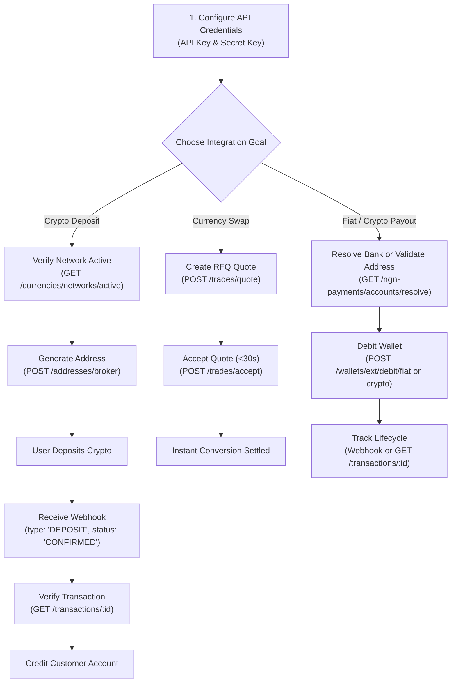

# Obiex Crypto & Fiat API Integration Skill

This skill guides you through integrating the Obiex REST API (`https://api.obiex.finance/v1/`) and official Node.js SDK (`obiex-api`) into backend services and financial applications. It covers HMAC-SHA256 request signing, crypto wallet deposit addresses, multi-customer virtual accounts with BVN/NIN identity verification, Request for Quote (RFQ) trading and instant swaps, crypto withdrawals, NGN fiat bank payouts, and webhook lifecycle management.

---

## Core Obiex Rules & Directives

1. **Environment Base URLs**:
   - **Staging (Sandbox)**: `https://staging.api.obiex.finance/v1/`
     - Used for integration testing. Real crypto is not moved, but real email notifications and webhooks fire.
     - Staging portal for creating test accounts: `https://staging.app.obiex.finance/auth/signup`
   - **Production (Live)**: `https://api.obiex.finance/v1/`
     - Live financial transactions, actual blockchain operations, and real bank payouts.
2. **System Currency and Network Codes (Strict)**:
   - Always supply exact **system codes**, never display names or colloquial terms:
     - Currency: Send `USDT`, `BTC`, `ETH`, `BNB`, `NGNX`, `GHS` (never `Tether` or `Bitcoin`).
     - Network: Send `TRX`, `BSC`, `BTC`, `ETH` (never `Tron (TRC20)` or `Binance Smart Chain`).
   - Query active mappings via `GET /currencies/networks/active` before initiating deposits or withdrawals.
3. **HMAC-SHA256 Request Authentication**:
   - Every authenticated request requires three headers:
     - `x-api-key`: API key from **Settings > Developers > API Keys**.
     - `x-api-timestamp`: Current Unix timestamp in milliseconds (e.g. `1761480000000`).
     - `x-api-signature`: Hex-encoded HMAC-SHA256 signature generated by signing `{METHOD}{path}{timestamp}` using your API Secret Key.
     - **Path Rule**: `path` must include the version prefix (e.g., `GET/v1/addresses/me/broker1761480000000`).
4. **Official Node.js / TypeScript SDK (`obiex-api`)**:
   - For Node.js/TypeScript (Node 20+), use the official `obiex-api` client (`ObiexClient`), which automatically computes signatures, manages timestamps, and routes between staging (`sandboxMode: true`) and production.
5. **Rate Limits & Constraints**:
   - Standard API rate limit: **200 requests per minute**.
   - Create Quote endpoint (`POST /trades/quote`): Strictly limited to **100 requests per hour**.
6. **Network Availability Validation (`isReceivable` & `isWithdrawable`)**:
   - Before generating a deposit address, verify `isReceivable: true` for that currency/network.
   - Before executing a crypto withdrawal, verify `isWithdrawable: true`.
7. **Deposit Address Idempotency (`uniqueUserIdentifier`)**:
   - When generating crypto deposit addresses via `POST /addresses/broker`, supply a stable `uniqueUserIdentifier` per user.
   - Reusing the same identifier returns the user's existing address across networks/currencies instead of exhausting address pools.
8. **Request-for-Quote (RFQ) Window (~30 Seconds)**:
   - Quotes generated via `POST /trades/quote` lock in guaranteed rates with zero extra slippage or hidden fees, but expire in ~30 seconds.
   - Accept promptly via `POST /trades/accept` with `quoteId`, or use atomic `POST /trades/instant-swap` for single-step execution.
9. **Multi-Customer Business Collections (Fiat Virtual Accounts)**:
   - Enables businesses to collect NGN payments from distinct customers via dynamic 30-minute virtual bank accounts with BVN/NIN KYC name matching.
   - Exact customer name match automatically converts fiat to `USDT` (or `USDC`) in your wallet.
   - Name mismatches hold payments safely in review rather than dropping funds.
10. **Withdrawal Status Lifecycle**:
    - Payout statuses transition through: `PENDING` -> `APPROVED` -> `PROCESSING` -> `SUCCESSFUL` (or `FAILED` / `REJECTED`).
    - Failed or rejected withdrawals automatically refund balances back to your Obiex wallet.
11. **Anti-Tampering Server Verification for Webhooks**:
    - Always acknowledge webhooks immediately with `200 OK`.
    - Before crediting customer accounts, query `GET /transactions/:id` to verify state directly against Obiex's ledger.

---

## Architecture & Integration Workflows

---

## Core Integration Workflows

### Workflow 1: Generating Crypto Deposit Addresses
1. **Check Active Networks**: Call `GET /currencies/networks/active` to verify `isReceivable: true` for the chosen currency and network code (e.g., `USDT` on `TRX`).
2. **Request Address**: Call `POST /addresses/broker` with:
   - `uniqueUserIdentifier`: Unique string identifying your customer (e.g., `user_c7a10f82`).
   - `currency`: System currency code (e.g., `USDT`).
   - `network`: System network code (e.g., `TRX`).
3. **Display to Customer**: Show the generated `address` (and optional `memo`/`tag` if applicable).
4. **Listen for Webhook**: Obiex dispatches a webhook with `type: "DEPOSIT"` when the transaction confirms on-chain.
> See [collections_and_deposits.md](./references/collections_and_deposits.md) for full implementation details.

### Workflow 2: Request-for-Quote (RFQ) Currency Swaps
1. **Fetch Trading Pairs & Rates**: Call `GET /trades/pairs` and `GET /trades/fiat-rates` to check market parameters.
2. **Request Guaranteed Quote**: Call `POST /trades/quote` with `sourceCurrency`, `targetCurrency`, `amount`, and `side` (`BUY` or `SELL`).
3. **Review Quote**: Check the returned rate, amount to receive, and `quoteId`. Notice that quotes are valid for ~30 seconds.
4. **Execute Trade**: Within the validity window, call `POST /trades/accept` with `{ "quoteId": "..." }`.
   - *Alternative*: For automated pipelines, call `POST /trades/instant-swap` to quote and execute atomically in a single request.
> See [trading_and_swaps.md](./references/trading_and_swaps.md).

### Workflow 3: Multi-Customer Business Collections (Fiat Virtual Accounts)
1. **Perform Customer KYC**: Collect customer's legal first name, last name, and BVN/NIN.
2. **Issue Virtual Bank Account**: Call `POST /collections` with customer details and target amount in `NGNX`.
3. **Customer Pays**: The customer transfers funds from their local bank account within the 30-minute validity window.
4. **Automated Settlement**:
   - If the sender bank account name matches KYC details, Obiex converts the fiat payment into `USDT` and credits your balance.
   - If a mismatch occurs, the funds are placed in manual review.
5. **Webhook Confirmation**: A `type: "COLLECTION"` webhook notifies your backend upon settlement.
> See [collections_and_deposits.md](./references/collections_and_deposits.md).

### Workflow 4: Outbound Crypto & Fiat Withdrawals (Payouts)
1. **Verify Balance**: Call `GET /wallets/:currencyCode` to ensure sufficient funds.
2. **Crypto Payout**:
   - Check network `isWithdrawable: true` via `GET /currencies/networks/active`.
   - Call `POST /wallets/ext/debit/crypto` with `currency`, `network`, `amount`, `address`, and optional `memo`.
3. **Fiat Payout (NGN Bank Transfer)**:
   - Query banks: `GET /ngn-payments/banks`.
   - Resolve account name: `GET /ngn-payments/accounts/resolve?accountNumber=...&bankCode=...`.
   - Call `POST /wallets/ext/debit/fiat` with bank details, `amount`, and currency.
4. **Monitor Status**: Listen for `type: "WITHDRAWAL"` webhooks as the status updates (`PROCESSING` -> `SUCCESSFUL`).
> See [payouts_and_withdrawals.md](./references/payouts_and_withdrawals.md).

### Workflow 5: Webhook Processing & Ledger Verification
1. Capture raw webhook payload.
2. Return HTTP `200 OK` immediately to acknowledge receipt and prevent timeout retries.
3. Inspect `type`:
   - `DEPOSIT`: Ensure `status === "CONFIRMED"` before crediting user balances.
   - `WITHDRAWAL`: Track payout completion (`SUCCESSFUL`) or rollback funds on `FAILED`/`REJECTED`.
   - `COLLECTION`: Process settled business collections.
4. **Server-Side Anti-Tampering Check**: Call `GET /transactions/:transactionId` to confirm the transaction authenticity against Obiex's API.
5. **Manual Webhook Replay**: If your server experiences downtime, call `POST /transactions/resendWebhooks` with an array of transaction IDs to replay events.
> See [webhook_handling.md](./references/webhook_handling.md).

---

## Reference Guides Index

| Topic | Reference Document | Description |
| :--- | :--- | :--- |
| **All API Endpoints** | [api_reference.md](./references/api_reference.md) | Complete Obiex v1 endpoint catalog, request payloads, and status codes |
| **Authentication & Request Signing** | [authentication_and_signing.md](./references/authentication_and_signing.md) | HMAC-SHA256 signature algorithms, headers, and code across Node.js, Python, Go, Rust |
| **Collections & Deposit Addresses** | [collections_and_deposits.md](./references/collections_and_deposits.md) | Crypto deposit addresses, `uniqueUserIdentifier`, and Multi-Customer Business Collections |
| **Trading & RFQ Swaps** | [trading_and_swaps.md](./references/trading_and_swaps.md) | RFQ workflow, rate limits (100 req/hr), quote expiration, and instant swaps |
| **Payouts & Withdrawals** | [payouts_and_withdrawals.md](./references/payouts_and_withdrawals.md) | Crypto on-chain debits, NGN bank account resolution, fiat off-ramping, status lifecycles |
| **Webhook Lifecycle & Security** | [webhook_handling.md](./references/webhook_handling.md) | Event formats (`DEPOSIT`, `WITHDRAWAL`, `COLLECTION`), verification, Express, Next.js, FastAPI, Django |
| **Testing & Troubleshooting** | [troubleshooting_and_testing.md](./references/troubleshooting_and_testing.md) | Staging environment, SDK setup, common error codes (401, 429, 422), network safety rules |

---

## Production Integration Checklist

Before deploying your Obiex integration to production, verify:

- [ ] **Secret Key Protection**: `x-api-secret` is stored strictly in environment variables (`OBIEX_API_SECRET`) and never exposed in client bundles.
- [ ] **System Currency & Network Codes**: All requests send official system codes (e.g. `USDT`, `TRX`), never full display names (e.g. `Tether`, `Tron`).
- [ ] **Active Network Validation**: Code verifies `isReceivable: true` before generating deposit addresses, and `isWithdrawable: true` before initiating withdrawals.
- [ ] **HMAC-SHA256 Signing Accuracy**: Signature message string matches `{METHOD}{path}{timestamp}` with path containing `/v1` prefix.
- [ ] **Timestamp Synchronization**: Server clock is synchronized via NTP to avoid timestamp skew rejection.
- [ ] **Deposit Idempotency**: `uniqueUserIdentifier` is stably tied to internal customer IDs in `POST /addresses/broker`.
- [ ] **Quote Rate Limit Handling**: Application respects the 100 req/hour limit on `POST /trades/quote` and handles quote expiration within 30 seconds.
- [ ] **Bank Account Resolution**: All fiat payouts verify account holder names via `GET /ngn-payments/accounts/resolve` prior to debit.
- [ ] **Anti-Tampering Webhook Verification**: Backend verifies transactions via `GET /transactions/:id` before fulfilling orders or crediting user balances.
- [ ] **Immediate 200 OK Response**: Webhook endpoints respond with HTTP 200 immediately before asynchronous task processing.
