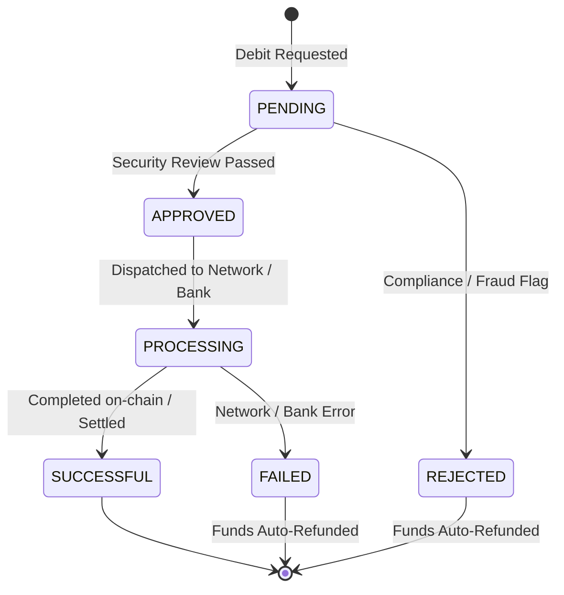

# Obiex Payouts & Withdrawals Guide

This guide covers outbound transfers and off-ramping using the Obiex API. You can withdraw funds to:
1. **External Blockchain Wallets** (Crypto Payouts).
2. **Local Bank Accounts** (Fiat Off-Ramping, e.g., Nigerian Naira).

---

## 1. Withdrawal Lifecycle Statuses

Every withdrawal request transitions through a defined state machine:



- **`PENDING`**: Request received, awaiting queued processing or approval.
- **`APPROVED`**: Cleared automated safety checks and queued for dispatch.
- **`PROCESSING`**: Broadcasted to the blockchain mempool or submitted to the banking switch.
- **`SUCCESSFUL`**: Payout reached final destination (or instantly if recipient is internal).
- **`FAILED`**: External blockchain or bank reject; funds are automatically reversed to your balance.
- **`REJECTED`**: Compliance rejection; funds reversed to your wallet within minutes.

---

## 2. Crypto Withdrawals (`POST /wallets/ext/debit/crypto`)

### Pre-Flight Verification
1. Call `GET /currencies/networks/active` and confirm `isWithdrawable: true` for the chosen currency and network.
2. Call `GET /wallets/:currencyCode` to verify sufficient available balance covering both amount and withdrawal fee.

### Request Payload
```json
{
  "currency": "USDT",
  "network": "TRX",
  "amount": 500,
  "address": "TLyqzVGLV1srkB7dToTAvZgqncAbc12345",
  "memo": null
}
```

> [!CAUTION]
> **Network Mismatch Warning**: Ensure the destination address format strictly corresponds to the chosen network (e.g. sending `USDT` over `TRX` requires a Tron `T...` address; sending over `BSC` requires an EVM `0x...` address). Sending crypto over incompatible networks results in permanent loss of funds.

---

## 3. Fiat Withdrawals / Off-Ramping (NGN Bank Payouts)

### 3-Step Payout Procedure
1. **Fetch Bank List**: Call `GET /ngn-payments/banks` to obtain official 3-digit bank codes.
2. **Resolve Bank Account**: Call `GET /ngn-payments/accounts/resolve` to verify the recipient account name before submitting funds.
3. **Execute Debit**: Call `POST /wallets/ext/debit/fiat` to convert crypto and disburse fiat directly to the bank account.

### Account Resolution Call
```http
GET /v1/ngn-payments/accounts/resolve?accountNumber=0123456789&bankCode=058
```
**Response**:
```json
{
  "accountNumber": "0123456789",
  "accountName": "Jane Doe",
  "bankCode": "058"
}
```

### Initiate Fiat Debit Payload (`POST /wallets/ext/debit/fiat`)
```json
{
  "amount": 75000,
  "currency": "NGNX",
  "accountNumber": "0123456789",
  "accountName": "Jane Doe",
  "bankName": "Guaranty Trust Bank",
  "bankCode": "058"
}
```

---

## 4. Code Implementations

### TypeScript / Node.js
```typescript
import { ObiexClient } from 'obiex-api';

const client = new ObiexClient({
  apiKey: process.env.OBIEX_API_KEY!,
  apiSecret: process.env.OBIEX_API_SECRET!,
  sandboxMode: false,
});

/**
 * Executes a verified fiat bank payout.
 */
export async function withdrawToNigerianBank(params: {
  amount: number;
  accountNumber: string;
  bankCode: string;
}) {
  // 1. Resolve Account Name
  const accountInfo = await client.resolveBankAccount({
    accountNumber: params.accountNumber,
    bankCode: params.bankCode,
  });

  // 2. Initiate Fiat Debit
  const payout = await client.withdrawNaira(params.amount, {
    accountNumber: params.accountNumber,
    accountName: accountInfo.accountName,
    bankName: accountInfo.bankName,
    bankCode: params.bankCode,
  });

  return payout;
}

/**
 * Initiates an on-chain cryptocurrency withdrawal.
 */
export async function withdrawCryptoFunds(params: {
  currency: string;
  network: string;
  amount: number;
  address: string;
  memo?: string;
}) {
  return await client.withdrawCrypto(params.currency, params.amount, {
    address: params.address,
    network: params.network,
    memo: params.memo,
  });
}
```

### Python
```python
from typing import Dict, Any, Optional
from .client import ObiexClient

def withdraw_crypto(
    client: ObiexClient,
    currency: str,
    network: str,
    amount: float,
    address: str,
    memo: Optional[str] = None,
) -> Dict[str, Any]:
    # 1. Validate network withdrawable status
    networks = client.get("/v1/currencies/networks/active")
    active_net = next(
        (n for n in networks.get(currency, []) if n.get("networkCode") == network),
        None
    )
    if not active_net or not active_net.get("isWithdrawable"):
        raise ValueError(f"Network {network} is not currently withdrawable for {currency}")

    # 2. Submit debit request
    payload = {
        "currency": currency,
        "network": network,
        "amount": amount,
        "address": address,
        "memo": memo,
    }
    return client.post("/v1/wallets/ext/debit/crypto", json_data=payload)

def withdraw_fiat_ngn(
    client: ObiexClient,
    amount: float,
    account_number: str,
    bank_code: str,
) -> Dict[str, Any]:
    # 1. Resolve account
    resolution = client.get(
        "/v1/ngn-payments/accounts/resolve",
        params={"accountNumber": account_number, "bankCode": bank_code},
    )
    account_name = resolution["accountName"]

    # 2. Execute payout
    payload = {
        "amount": amount,
        "currency": "NGNX",
        "accountNumber": account_number,
        "accountName": account_name,
        "bankCode": bank_code,
    }
    return client.post("/v1/wallets/ext/debit/fiat", json_data=payload)
```

### Go
```go
package payouts

import (
	"bytes"
	"encoding/json"
	"fmt"
	"net/http"
)

type CryptoWithdrawRequest struct {
	Currency string  `json:"currency"`
	Network  string  `json:"network"`
	Amount   float64 `json:"amount"`
	Address  string  `json:"address"`
	Memo     *string `json:"memo,omitempty"`
}

type FiatWithdrawRequest struct {
	Amount        float64 `json:"amount"`
	Currency      string  `json:"currency"`
	AccountNumber string  `json:"accountNumber"`
	AccountName   string  `json:"accountName"`
	BankCode      string  `json:"bankCode"`
}

func WithdrawCrypto(client *http.Client, baseURL string, req CryptoWithdrawRequest) error {
	payload, err := json.Marshal(req)
	if err != nil {
		return err
	}

	httpReq, err := http.NewRequest(http.MethodPost, baseURL+"/v1/wallets/ext/debit/crypto", bytes.NewReader(payload))
	if err != nil {
		return err
	}
	httpReq.Header.Set("Content-Type", "application/json")

	resp, err := client.Do(httpReq)
	if err != nil {
		return err
	}
	defer resp.Body.Close()

	if resp.StatusCode != http.StatusOK && resp.StatusCode != http.StatusCreated {
		return fmt.Errorf("crypto withdrawal failed: %s", resp.Status)
	}

	return nil
}
```
