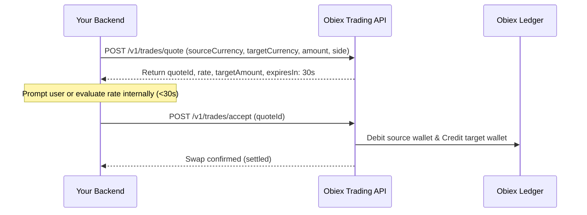

# Obiex Trading & RFQ Swaps Guide

This guide covers currency conversion, hedging, and instant asset swaps using the Obiex Trading API. Obiex implements a **Request for Quote (RFQ)** model alongside single-call **Instant Swaps**, offering guaranteed exchange rates with zero slippage.

---

## 1. RFQ vs. Instant Swap Architecture

| Feature | Two-Step RFQ (`quote` -> `accept`) | Single-Step `instant-swap` |
| :--- | :--- | :--- |
| **Workflow** | `POST /trades/quote` then `POST /trades/accept` | `POST /trades/instant-swap` |
| **Best Used For** | User-facing UIs where customer reviews rate before confirming | Automated backend pipelines, automated treasury rebalancing |
| **Price Guarantee** | Rate locked for ~30 seconds via `quoteId` | Rate determined and filled immediately at execution time |
| **Rate Limit** | Stricter: **100 quote requests per hour** | Standard global rate limit (200 req/min) |

---

## 2. RFQ Trading Workflow (Two-Step)



### Step 1: Create Quote (`POST /trades/quote`)
- **Rate Limit**: 100 requests per hour.
- **Request Payload**:
```json
{
  "sourceCurrency": "USDT",
  "targetCurrency": "BTC",
  "amount": 1000,
  "side": "BUY"
}
```
- **Response**:
```json
{
  "quoteId": "quot_99a81c-4b72-4d51-9f93",
  "sourceCurrency": "USDT",
  "targetCurrency": "BTC",
  "sourceAmount": 1000,
  "targetAmount": 0.01052631,
  "rate": 95000.0,
  "expiresIn": 30
}
```

### Step 2: Accept Quote (`POST /trades/accept`)
Execute the trade within the 30-second window:
```json
{
  "quoteId": "quot_99a81c-4b72-4d51-9f93"
}
```
- **Response**: Returns confirmation payload indicating the swap is completed and funds are settled.
- **Error Condition**: If called after `expiresIn` has elapsed, returns HTTP `422 Unprocessable Entity` with an expired quote message.

---

## 3. Instant Swap Workflow (Single-Step)

For automated systems (e.g. converting received deposits instantly to stablecoins or fiat), use `POST /trades/instant-swap` to eliminate the two-step roundtrip:

- **Endpoint**: `POST /v1/trades/instant-swap`
- **Request Payload**:
```json
{
  "sourceCurrency": "USDT",
  "targetCurrency": "NGNX",
  "amount": 200,
  "side": "SELL"
}
```
- **Response**: Instantly executes the swap at prevailing market rate and returns the settled transaction details.

---

## 4. Code Implementations

### TypeScript / Node.js
```typescript
import { ObiexClient, ServerError } from 'obiex-api';

const client = new ObiexClient({
  apiKey: process.env.OBIEX_API_KEY!,
  apiSecret: process.env.OBIEX_API_SECRET!,
  sandboxMode: false,
});

/**
 * Executes a guaranteed RFQ swap with expiration guard.
 */
export async function executeRfqSwap(
  sourceCurrency: string,
  targetCurrency: string,
  amount: number,
  side: 'BUY' | 'SELL'
) {
  try {
    // 1. Check wallet balance
    const balance = await client.getWalletBalance(sourceCurrency);
    if (parseFloat(balance.available) < amount) {
      throw new Error(`Insufficient ${sourceCurrency} balance`);
    }

    // 2. Request Quote
    const quote = await client.createQuote({
      sourceCurrency,
      targetCurrency,
      amount,
      side,
    });

    console.log(`Quote received. Rate: ${quote.rate}, Valid for: ${quote.expiresIn}s`);

    // 3. Accept Quote promptly
    const trade = await client.acceptQuote(quote.quoteId);
    return trade;
  } catch (error) {
    if (error instanceof ServerError) {
      console.error(`Obiex Swap Error [${error.status}]:`, error.message);
    }
    throw error;
  }
}
```

### Python
```python
from typing import Dict, Any
from .client import ObiexClient

def execute_swap_rfq(
    client: ObiexClient,
    source_currency: str,
    target_currency: str,
    amount: float,
    side: str = "BUY",
) -> Dict[str, Any]:
    # 1. Balance verification
    wallet = client.get(f"/v1/wallets/{source_currency}")
    if float(wallet.get("available", 0)) < amount:
        raise ValueError(f"Insufficient {source_currency} balance")

    # 2. Create Quote
    quote_payload = {
        "sourceCurrency": source_currency,
        "targetCurrency": target_currency,
        "amount": amount,
        "side": side,
    }
    quote = client.post("/v1/trades/quote", json_data=quote_payload)
    quote_id = quote["quoteId"]

    # 3. Accept Quote
    return client.post("/v1/trades/accept", json_data={"quoteId": quote_id})

def execute_instant_swap(
    client: ObiexClient,
    source_currency: str,
    target_currency: str,
    amount: float,
    side: str = "SELL",
) -> Dict[str, Any]:
    payload = {
        "sourceCurrency": source_currency,
        "targetCurrency": target_currency,
        "amount": amount,
        "side": side,
    }
    return client.post("/v1/trades/instant-swap", json_data=payload)
```

### Go
```go
package trades

import (
	"bytes"
	"encoding/json"
	"fmt"
	"net/http"
)

type QuoteRequest struct {
	SourceCurrency string  `json:"sourceCurrency"`
	TargetCurrency string  `json:"targetCurrency"`
	Amount         float64 `json:"amount"`
	Side           string  `json:"side"` // "BUY" or "SELL"
}

type QuoteResponse struct {
	QuoteID      string  `json:"quoteId"`
	SourceAmount float64 `json:"sourceAmount"`
	TargetAmount float64 `json:"targetAmount"`
	Rate         float64 `json:"rate"`
	ExpiresIn    int     `json:"expiresIn"`
}

type AcceptQuoteRequest struct {
	QuoteID string `json:"quoteId"`
}

func PerformRFQSwap(client *http.Client, baseURL string, req QuoteRequest) error {
	// 1. Create Quote
	quoteBody, err := json.Marshal(req)
	if err != nil {
		return err
	}

	quoteReq, err := http.NewRequest(http.MethodPost, baseURL+"/v1/trades/quote", bytes.NewReader(quoteBody))
	if err != nil {
		return err
	}
	quoteReq.Header.Set("Content-Type", "application/json")

	quoteResp, err := client.Do(quoteReq)
	if err != nil {
		return err
	}
	defer quoteResp.Body.Close()

	if quoteResp.StatusCode != http.StatusOK && quoteResp.StatusCode != http.StatusCreated {
		return fmt.Errorf("failed to create quote: status %s", quoteResp.Status)
	}

	var quote QuoteResponse
	if err := json.NewDecoder(quoteResp.Body).Decode(&quote); err != nil {
		return err
	}

	// 2. Accept Quote
	acceptBody, err := json.Marshal(AcceptQuoteRequest{QuoteID: quote.QuoteID})
	if err != nil {
		return err
	}

	acceptReq, err := http.NewRequest(http.MethodPost, baseURL+"/v1/trades/accept", bytes.NewReader(acceptBody))
	if err != nil {
		return err
	}
	acceptReq.Header.Set("Content-Type", "application/json")

	acceptResp, err := client.Do(acceptReq)
	if err != nil {
		return err
	}
	defer acceptResp.Body.Close()

	if acceptResp.StatusCode != http.StatusOK && acceptResp.StatusCode != http.StatusCreated {
		return fmt.Errorf("failed to accept quote: status %s", acceptResp.Status)
	}

	return nil
}
```
