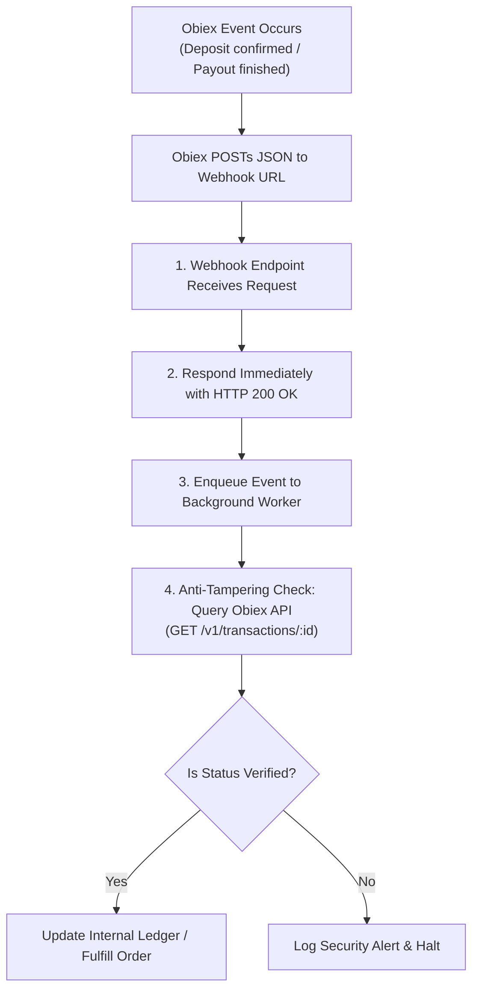

# Obiex Webhook Handling & Security Guide

This guide covers listening for real-time transaction updates from Obiex. Webhooks notify your application when cryptocurrency deposits confirm, payouts complete or fail, and multi-customer fiat collections settle.

---

## 1. Webhook Lifecycle & Architecture



### Essential Security Invariants
1. **Always Acknowledge with 200 OK**: Return HTTP 200 immediately upon receiving the payload. Do not perform blocking operations or slow database queries in the synchronous request handler.
2. **Anti-Tampering Server-Side Verification**: Before granting financial balance or dispatching goods, query Obiex directly (`GET /v1/transactions/:id`) to verify that the transaction ID and amounts match records on Obiex's authoritative ledger.
3. **Idempotent Event Processing**: Maintain an `idempotency_keys` or `processed_events` table indexed by `transactionId` or transaction `hash` to prevent double-crediting if an event is re-delivered.

---

## 2. Event Types & Payloads

### Event: `DEPOSIT`
Fired when a user sends cryptocurrency to a generated broker deposit address.

```json
{
  "hash": "0xe62236173d7427b73782c4d09863f01de418b7a2029841bcabfb35870c8d4f6c",
  "type": "DEPOSIT",
  "currency": "USDT",
  "network": "TRX",
  "address": "TNPwF88VzW5CjXpWw9tP8YmYhYw9876543",
  "amount": 250.0,
  "status": "CONFIRMED",
  "transactionId": "tx_88192a-33bc",
  "timestamp": "2026-11-14T10:30:00Z"
}
```

> [!IMPORTANT]
> Only credit balances when `status === "CONFIRMED"`. If status is `PENDING` or unconfirmed, wait for the confirmation webhook.

### Event: `WITHDRAWAL`
Fired when an external crypto or fiat payout updates in status.

```json
{
  "type": "WITHDRAWAL",
  "currency": "USDT",
  "network": "TRX",
  "address": "TLyqzVGLV1srkB7dToTAvZgqncAbc12345",
  "amount": 100.0,
  "status": "SUCCESSFUL",
  "transactionId": "tx_99214b-77da",
  "hash": "0x448a912...",
  "timestamp": "2026-11-14T10:35:00Z"
}
```

- When `status === "SUCCESSFUL"`, mark the payout as completed.
- When `status === "FAILED"` or `"REJECTED"`, Obiex automatically refunds the balance; update your internal record and alert the user.

### Event: `COLLECTION`
Fired when a customer pays into a Business Collection dynamic virtual account.

```json
{
  "type": "COLLECTION",
  "collectionId": "col_76ab91-23fe-4411",
  "amountReceived": 75000,
  "sourceCurrency": "NGNX",
  "targetCurrency": "USDT",
  "amountSettled": 48.35,
  "status": "SETTLED",
  "customerName": "Emeka Okafor",
  "matched": true,
  "transactionId": "tx_123456-7890",
  "timestamp": "2026-11-14T10:40:00Z"
}
```

---

## 3. Webhook Replay & Recovery Endpoints

If your server was temporarily down or missed webhook notifications, Obiex allows programmatic re-dispatching:

### Resend Single Webhook
```http
POST /v1/transactions/resendWebhook
Content-Type: application/json

{
  "id": "tx_88192a-33bc"
}
```

### Resend Batch Webhooks
```http
POST /v1/transactions/resendWebhooks
Content-Type: application/json

{
  "ids": ["tx_88192a-33bc", "tx_99214b-77da"]
}
```

---

## 4. Multi-Framework Implementations

### Express.js (Node.js)
```typescript
import express, { Request, Response } from 'express';
import { ObiexClient } from 'obiex-api';

const app = express();
app.use(express.json());

const obiex = new ObiexClient({
  apiKey: process.env.OBIEX_API_KEY!,
  apiSecret: process.env.OBIEX_API_SECRET!,
});

app.post('/api/webhooks/obiex', async (req: Request, res: Response) => {
  const event = req.body;

  // 1. Acknowledge receipt immediately
  res.status(200).json({ received: true });

  // 2. Offload processing to background task
  setImmediate(async () => {
    try {
      const transactionId = event.transactionId || event.id;
      if (!transactionId) return;

      // Anti-tampering check: verify directly with Obiex
      const verifiedTx = await obiex.getTransaction(transactionId);
      if (!verifiedTx) return;

      switch (event.type) {
        case 'DEPOSIT':
          if (verifiedTx.status === 'CONFIRMED') {
            await creditUserDeposit(verifiedTx);
          }
          break;
        case 'WITHDRAWAL':
          await updateWithdrawalStatus(verifiedTx);
          break;
        case 'COLLECTION':
          await handleBusinessCollection(verifiedTx);
          break;
      }
    } catch (err) {
      console.error('Webhook async processing failed:', err);
    }
  });
});
```

### Next.js App Router (Route Handler)
```typescript
import { NextRequest, NextResponse } from 'next/server';
import { ObiexClient } from 'obiex-api';

const obiex = new ObiexClient({
  apiKey: process.env.OBIEX_API_KEY!,
  apiSecret: process.env.OBIEX_API_SECRET!,
});

export async function POST(req: NextRequest) {
  try {
    const event = await req.json();

    const transactionId = event.transactionId || event.id;
    if (transactionId) {
      // Perform server verification
      const verified = await obiex.getTransaction(transactionId);
      if (verified && verified.status === 'CONFIRMED' && event.type === 'DEPOSIT') {
        // Enqueue background processing or perform atomic balance update
      }
    }

    return NextResponse.json({ status: 'ok' }, { status: 200 });
  } catch (error) {
    return NextResponse.json({ error: 'Webhook processing error' }, { status: 400 });
  }
}
```

### FastAPI (Python)
```python
from fastapi import FastAPI, BackgroundTasks, Request, status
from fastapi.responses import JSONResponse
from .client import ObiexClient

app = FastAPI()
obiex = ObiexClient(api_key="...", api_secret="...")

async def process_obiex_event(event: dict):
    tx_id = event.get("transactionId") or event.get("id")
    if not tx_id:
        return

    # Anti-tampering check against Obiex API
    verified = obiex.get(f"/v1/transactions/{tx_id}")
    event_type = event.get("type")

    if event_type == "DEPOSIT" and verified.get("status") == "CONFIRMED":
        # Credit user wallet atomically
        pass
    elif event_type == "WITHDRAWAL":
        # Finalize withdrawal state
        pass

@app.post("/webhooks/obiex", status_code=status.HTTP_200_OK)
async def handle_webhook(request: Request, background_tasks: BackgroundTasks):
    payload = await request.json()
    background_tasks.add_task(process_obiex_event, payload)
    return JSONResponse(status_code=200, content={"received": True})
```
