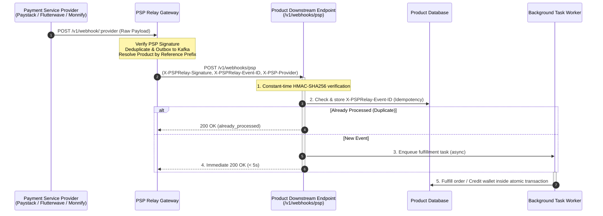

# PSP Relay Downstream Integration Skill

This skill guides backend engineers and AI coding agents through integrating downstream product microservices with **PSP Relay** ([github.com/Ayobami6/psprelay](https://github.com/Ayobami6/psprelay)).

PSP Relay acts as a single-ingress webhook gateway for Payment Service Providers (Paystack, Flutterwave, Monnify, etc.) that validates provider signatures, buffers events in Kafka, deterministically routes webhooks to the appropriate product service based on payment reference prefixes, and delivers them with automatic retries and dead-letter queuing.

---

## Core Downstream Invariants & Rules

1. **Verify Relay Signature (`X-PSPRelay-Signature`)**:
   - Downstream endpoints must validate the `X-PSPRelay-Signature` HTTP header before processing any payload.
   - The signature is a lowercase hex-encoded **HMAC-SHA256** of the **exact, unparsed raw request body** generated using your product's configured `signatureKey`:
     $$\text{ExpectedSig} = \text{hex}(\text{HMAC-SHA256}(\text{RawBody}, \text{signatureKey}))$$
   - Always perform constant-time equality checks (`crypto.timingSafeEqual`, `hmac.compare_digest`, or `hmac.Equal`) to mitigate timing attacks.
2. **Idempotency Deduplication (`X-PSPRelay-Event-ID`)**:
   - PSP Relay delivers events with **at-least-once** semantics (network retries, worker restarts, or Kafka consumer rebalancing can cause duplicate deliveries).
   - Use `X-PSPRelay-Event-ID` as your primary deduplication key. Persist it in an idempotent database table (`processed_relay_events`) or distributed cache.
   - If `X-PSPRelay-Event-ID` has already been processed, return `HTTP 200 OK` immediately without re-executing business logic (e.g., crediting wallets, granting subscriptions).
3. **Fast 2xx Acknowledgment (< 5 Seconds)**:
   - PSP Relay treats any delivery attempt taking longer than **5 seconds** as a failure and triggers an exponential retry.
   - Return `HTTP 200 OK` (or `202 Accepted`) immediately after signature validation and event persistence.
   - Offload heavy operations (sending emails, issuing receipts, external API calls, DB locking) to an asynchronous background worker (Celery, ARQ, BullMQ, Go goroutines).
4. **Outbound Payment Reference Tagging**:
   - When your product initiates a payment or charges a customer with a PSP, you must tag the transaction's `reference` or `tx_ref` so PSP Relay can route the webhook to your service:
     - **Option A: HMAC Prefix Token (Recommended)**: Obscures internal product identifiers while ensuring tamper-proof routing:
       $$\text{Ref} = \text{hex}(\text{HMAC-SHA256}(\text{prefix}, \text{encodeKey}))[:12] + \text{"\_"} + \text{internalID}$$
       *(Example: `3f9a1c0be27d_inv_982341`)*
     - **Option B: Plaintext Prefix**:
       $$\text{Ref} = \text{PREFIX} + \text{"\_"} + \text{internalID}$$
       *(Example: `MN_inv_982341` or `TC_sub_88192`)*
   - Untagged or unrecognized references fail closed into PSP Relay's Dead-Letter Queue (`psp.webhooks.dlq`).
5. **Exact Byte-for-Byte Original Payload**:
   - PSP Relay **does not wrap, nest, or modify** the provider's JSON payload. Downstream services receive the exact authentic payload generated by Paystack (`charge.success`), Flutterwave (`charge.completed`), or Monnify (`SUCCESSFUL_TRANSACTION`).
6. **Preserved Original PSP Headers**:
   - Original PSP headers (such as `X-Paystack-Signature`, `verif-hash`, or `monnify-signature`) are forwarded downstream, allowing double-verification if required by policy.
7. **Retry Counter (`X-PSPRelay-Retry-Attempt`)**:
   - On retry deliveries, PSP Relay includes `X-PSPRelay-Retry-Attempt: 1`, `2`, or `3`. Use this header for telemetry, alerting, and diagnosing slow downstream handlers.

---

## Downstream Delivery Sequence

---

## Downstream Integration Checklist & Workflows

### Workflow 1: Receiving & Verifying Relayed Webhooks
1. **Capture Raw Request Body**: Ensure your HTTP server captures the raw body bytes/buffer before JSON parsing.
2. **Inspect Headers**:
   - Read `X-PSPRelay-Signature` and verify against `hex(HMAC-SHA256(rawBody, signatureKey))`.
   - Read `X-PSPRelay-Event-ID` for deduplication.
   - Read `X-PSP-Provider` to identify whether the event originated from `paystack`, `flutterwave`, or `monnify`.
3. **Check Idempotency**: Verify if `X-PSPRelay-Event-ID` was already recorded. If yes, respond `200 OK` and exit.
4. **Enqueue Asynchronous Fulfillment**: Pass the event ID, provider, and payload to your task queue.
5. **Return HTTP 200**: Respond with HTTP `200 OK` within 5 seconds.
> See [downstream_verification.md](./references/downstream_verification.md) for complete implementations in Express, Next.js, FastAPI, Django, and Go.

### Workflow 2: Tagging Outbound Payment References
1. When generating a payment link, card debit, or virtual account with a PSP, format the reference using your product's configured prefix and `encodeKey`.
2. Compute the 12-character HMAC token:
   - `token = hex(HMAC-SHA256(prefix, encodeKey))[:12]`
   - `reference = f"{token}_{order_id}"`
3. Pass `reference` to the provider:
   - **Paystack**: `reference` field in `POST /transaction/initialize`.
   - **Flutterwave**: `tx_ref` field in `POST /v3/payments`.
   - **Monnify**: `paymentReference` in `POST /api/v1/merchant/transactions/init-transaction`.
> See [outbound_reference_tagging.md](./references/outbound_reference_tagging.md).

---

## Reference Guides Index

| Topic | Reference Document | Description |
| :--- | :--- | :--- |
| **API & Payload Reference** | [api_and_payload_reference.md](./references/api_and_payload_reference.md) | Relayed request headers, exact provider payload structures (Paystack, Flutterwave, Monnify), and Admin API replay endpoints |
| **Downstream Verification** | [downstream_verification.md](./references/downstream_verification.md) | Cryptographic HMAC-SHA256 signature verification algorithms with implementations in Express, Next.js, FastAPI, Django, Go, and Rust |
| **Outbound Reference Tagging** | [outbound_reference_tagging.md](./references/outbound_reference_tagging.md) | Deterministic routing mechanics, HMAC prefix tokens vs plaintext prefixes, and reference generation helpers |
| **Idempotency & Processing** | [idempotency_and_event_handling.md](./references/idempotency_and_event_handling.md) | At-least-once delivery handling, database deduplication schemas, retry counters, and fast <5s response patterns |
| **Troubleshooting & DLQ** | [troubleshooting_and_dlq.md](./references/troubleshooting_and_dlq.md) | Common errors (401 invalid signature, 5-second timeouts, unmatched prefixes), DLQ inspection, and manual replaying |

---

## Production Integration Checklist

Before deploying your downstream service behind PSP Relay, verify:

- [ ] **Signature Key Storage**: Product `signatureKey` is stored securely in environment variables (`PSP_RELAY_SIGNATURE_KEY`) and never hardcoded.
- [ ] **Raw Body Capture**: Downstream HTTP handler verifies signatures against the unparsed byte buffer, not re-serialized JSON.
- [ ] **Constant-Time Comparison**: Signature verification uses timing-safe equality checks (`crypto.timingSafeEqual` / `hmac.compare_digest` / `hmac.Equal`).
- [ ] **Event ID Deduplication**: Database table or Redis cache enforces unique constraints on `X-PSPRelay-Event-ID`.
- [ ] **< 5s Acknowledgment Timeout**: Endpoints respond with HTTP 200 within 5 seconds; slow database writes or external network calls are delegated to background queues.
- [ ] **Outbound Reference Tagging**: All charges initiated with PSPs have references prefixed with the product's HMAC token or configured prefix.
- [ ] **Provider-Specific Handling**: Downstream logic switches parsing based on `X-PSP-Provider` (`paystack`, `flutterwave`, `monnify`).
