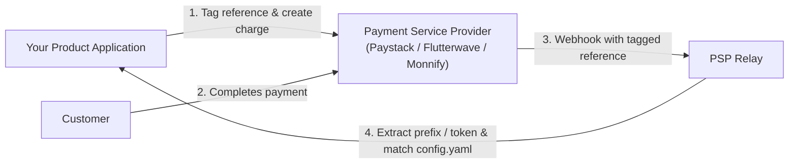

# Outbound Reference Tagging Guide

This guide explains how downstream product microservices must tag outgoing payment references when creating transactions with Payment Service Providers (PSPs). Proper tagging enables **PSP Relay** to deterministically route the resulting incoming webhooks to the correct product service.

---

## 1. How Deterministic Routing Works

When a PSP receives a payment, it includes the merchant's payment reference in its webhook payload (e.g. `data.reference` in Paystack, `data.tx_ref` in Flutterwave, or `eventData.paymentReference` in Monnify).



PSP Relay inspects the payment reference and matches it against the configured products in `config.yaml` using two supported methods:
1. **HMAC Prefix Token (Recommended)**: A cryptographic hash of the product's prefix using its `encodeKey`.
2. **Plaintext Prefix**: A raw 2-4 character prefix.

If an incoming reference does not match any product's configured prefix or HMAC token, PSP Relay drops it from normal fan-out and routes it directly to the Dead-Letter Queue (`psp.webhooks.dlq`).

---

## 2. Tagging Strategies

### Option A: HMAC Prefix Token (Recommended)
This method hides internal product names (e.g. `mailnow`, `tibicloud`) from checkout pages, receipts, and user bank statements, while providing tamper-proof routing.

#### Formula
$$\text{Token} = \text{hex}(\text{HMAC-SHA256}(\text{prefix}, \text{encodeKey}))[:12]$$
$$\text{FullReference} = \text{Token} + \text{"\_"} + \text{InternalTransactionUUID}$$

- `prefix`: The 2-4 character product prefix defined in `config.yaml` (e.g., `"MN"`).
- `encodeKey`: The 16-32 character secret key configured under `products.<product>.secrets.encodeKey`.
- `Token`: The first 12 characters of the resulting lowercase hexadecimal hash.

*Example*: If `prefix = "MN"` and `encodeKey = "f4a9b2c8e1d70356"`, the 12-character token is `3f9a1c0be27d`.
The resulting reference is:
```text
3f9a1c0be27d_inv_982341
```

### Option B: Plaintext Prefix
A simpler alternative where the product prefix is prepended directly:

$$\text{FullReference} = \text{PREFIX} + \text{"\_"} + \text{InternalTransactionUUID}$$

*Example*:
```text
MN_inv_982341
```

---

## 3. Reference Generator Helpers

### TypeScript / Node.js
```typescript
import crypto from 'node:crypto';

/**
 * Generates an HMAC-tagged payment reference for PSP Relay.
 */
export function generateRelayReference(
  internalId: string,
  prefix: string = process.env.PRODUCT_PREFIX || 'MN',
  encodeKey: string = process.env.PSP_RELAY_ENCODE_KEY || 'f4a9b2c8e1d70356'
): string {
  const token = crypto
    .createHmac('sha256', encodeKey)
    .update(prefix)
    .digest('hex')
    .slice(0, 12);

  return `${token}_${internalId}`;
}

/**
 * Generates a plaintext prefixed reference.
 */
export function generatePlaintextReference(
  internalId: string,
  prefix: string = process.env.PRODUCT_PREFIX || 'MN'
): string {
  return `${prefix}_${internalId}`;
}
```

### Python
```python
import hmac
import hashlib
import os

def generate_relay_reference(
    internal_id: str,
    prefix: str = os.getenv("PRODUCT_PREFIX", "MN"),
    encode_key: str = os.getenv("PSP_RELAY_ENCODE_KEY", "f4a9b2c8e1d70356")
) -> str:
    """Generates an HMAC-tagged reference for PSP Relay."""
    token = hmac.new(
        encode_key.encode("utf-8"),
        prefix.encode("utf-8"),
        hashlib.sha256
    ).hexdigest()[:12]
    return f"{token}_{internal_id}"

def generate_plaintext_reference(
    internal_id: str,
    prefix: str = os.getenv("PRODUCT_PREFIX", "MN")
) -> str:
    """Generates a plaintext-prefixed reference."""
    return f"{prefix}_{internal_id}"
```

### Go
```go
package reference

import (
	"crypto/hmac"
	"crypto/sha256"
	"encoding/hex"
	"fmt"
)

func GenerateRelayReference(internalID, prefix, encodeKey string) string {
	mac := hmac.New(sha256.New, []byte(encodeKey))
	mac.Write([]byte(prefix))
	token := hex.EncodeToString(mac.Sum(nil))[:12]
	return fmt.Sprintf("%s_%s", token, internalID)
}

func GeneratePlaintextReference(internalID, prefix string) string {
	return fmt.Sprintf("%s_%s", prefix, internalID)
}
```

---

## 4. Provider Field Mapping

When dispatching requests to payment providers, supply the generated reference in their respective reference field:

| Provider | API Endpoint | Reference Field Name | Example Payload Excerpt |
| :--- | :--- | :--- | :--- |
| **Paystack** | `POST /transaction/initialize` | `reference` | `{"reference": "3f9a1c0be27d_inv_982341", "amount": 250000}` |
| **Flutterwave** | `POST /v3/payments` | `tx_ref` | `{"tx_ref": "3f9a1c0be27d_inv_982341", "amount": 2500}` |
| **Monnify** | `POST /api/v1/merchant/transactions/init-transaction` | `paymentReference` | `{"paymentReference": "3f9a1c0be27d_inv_982341", ...}` |
| **Monnify DVA** | `POST /api/v2/bank-transfer/reserved-accounts` | `accountReference` | `{"accountReference": "3f9a1c0be27d_dva_982341", ...}` |
